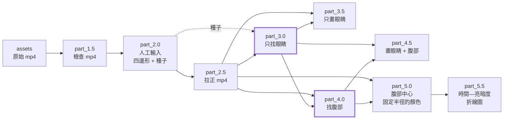

# 烏賊影片分析

從約兩天、每分鐘一個 mp4 的水槽影片，追蹤一隻小烏賊的**右眼、左眼、腹部**，並量測**腹部中心固定半徑內的顏色**，畫成「時間 — 亮暗度」折線圖。
流程由九個 part 組成，用 `run_all` 一次跑完，或一個一個跑（也可以只跑中間幾個）。

| 想做什麼 | 看哪裡 |
| --- | --- |
| 馬上跑起來 | [快速開始](#快速開始) |
| 專案怎麼擺、有哪些規則 | [專案架構與規則](#專案架構與規則) |
| 整體流程為什麼這樣設計 | [整體流程與原因](#整體流程與原因) |
| 追蹤結果不對、要調參數 | [調參的工作流程](#調參的工作流程) |
| 某個 part 的細節 | [各資料夾的 README](#各資料夾的-readme) |

## 快速開始

### INTRO
網址：https://github.com/anunnamedtank24/squid_video_analysis
下載後可以自行跑一遍，但要補 squid_video_analysis/assets（mp4 from cloud drive）和 venv。請依序執行：
```bash
# macOS only
brew install python@3.12 python-tk@3.12

# 本地專案路徑
cd $SQUID_VIDEO_ANALYSIS

python3.12 -m venv venv
venv/bin/pip install -r requirements.txt
venv/bin/python bin/run_all.py manifest.json $START_MIN $END_MIN
```
架構：
```text
1.5 檢查 mp4
→ 2.0 手動點四邊形、右眼、左眼、腹部
→ 2.5 擷取並拉正
→ 3.0 追蹤兩眼
→ 3.5 把眼睛畫回影片
→ 4.0 找腹部
→ 4.5 把眼睛＋腹部畫回影片
→ 5.0 算腹部圓內（固定半徑）顏色／亮度
→ 5.5 時間－亮度折線圖
```
n.0 是運算（json），n.5 是給人看的檢查（影片或圖）。
可一鍵 run_all，也可用 --start / --end 只跑幾步。
輸出：output/起始分鐘_結束分鐘/part_X/。
也可以不跑，直接看 samples 裡的結果（見 smaples）。

### 1. 環境

```bash
python3 -m venv venv
venv/bin/pip install -r requirements.txt
```

- `manifest.json` 的 `python` 欄位指向這個 venv 的 python（預設 `venv/bin/python`）；run_all 用它啟動每個 part。
- part_2.0 是互動視窗，需要 tkinter + Pillow。macOS 沒有 tkinter 時：`brew install python-tk@3.12`，並用該版本的 python 建 venv（細節見 [part_2.0](src/part_2.0/README.md)）。其他 part 不需要 tkinter。

### 2. 放入影片

```text
assets/{任意}/{YYYYMMDDHH}/NN{任意}.mp4      NN = 分鐘 00~59
```

每分鐘一個 mp4。jpeg 一律忽略。

### 3. 執行

```bash
# 全部跑（時間範圍含頭尾，12 位 YYYYMMDDHHMM）
python3 src/run_all/run_all_main.py manifest.json 202605211317 202605211359

# 只跑其中幾個 part（含頭尾）：例如重跑眼睛追蹤並重畫眼睛
python3 src/run_all/run_all_main.py manifest.json 202605211317 202605211359 --start 3.0 --end 3.5

# 眼睛已經追好，只重調腹部：重找腹部、重畫、重算顏色
python3 src/run_all/run_all_main.py manifest.json 202605211317 202605211359 --start 4.0 --end 5.5

# 單獨跑一個 part：每個 part 的引數都相同
python3 src/part_3.0/part_3.0_main.py manifest.json 202605211317 202605211359
```

輸出在 `output/{START}_{END}/part_X/`。

> [!NOTE]
> 第一次跑 part_2.0 會開兩個視窗：視窗一點水槽的四邊形，視窗二在拉正後的畫面上依序點右眼、左眼、腹部。這是整條流程唯一需要人做的事。

## 專案架構與規則

### 資料夾

```text
project/
├── README.md                    本檔
├── requirements.txt             套件（numpy / opencv-python-headless / Pillow / av / matplotlib）
├── .gitignore                   不進版控：assets/、venv/、output/、__pycache__/、.DS_Store
├── manifest.json                所有路徑都記在這裡（見下）
├── config.json                  所有參數都在這裡（見下）
├── assets/{任意}/{YYYYMMDDHH}/NN{…}.mp4 gitignore、從雲端下載
├── venv/                               gitignore、python 路徑在 manifest 裡 需自行設定 py 直譯器
├── src/
│   ├── run_all/    run_all_main.py     README.md
│   ├── part_1.5/   part_1.5_main.py    README.md
│   ├── part_2.0/   part_2.0_main.py    README.md
│   ├── part_2.5/   part_2.5_main.py    README.md
│   ├── part_3.0/   part_3.0_main.py    README.md
│   ├── part_3.5/   part_3.5_main.py    README.md
│   ├── part_4.0/   part_4.0_main.py    README.md
│   ├── part_4.5/   part_4.5_main.py    README.md
│   ├── part_5.0/   part_5.0_main.py    README.md
│   ├── part_5.5/   part_5.5_main.py    README.md
│   └── tool/       tool_main.py  tool_manifest.py  README.md
├── bin/                                入口（run_all）
├── output/                             gitignore
│   └── {START}_{END}/                  每個時間範圍 = 一次完整執行
│       └── part_1.5/ … part_5.5/       資料夾名稱固定
└── sample/                             搬遷測試結果 output
```

### 規則

| 規則 | 內容 | 為什麼 |
| --- | --- | --- |
| **一個 part 一個資料夾** | `src/{part}/{part}_main.py` + `README.md`；腳本檔名全專案唯一 | 每個 part 可以單獨執行、單獨搬走；檔名不重複，匯入共用函數不會撞名 |
| **路徑只寫在 manifest** | 腳本的第一個引數一律是 `manifest.json`，程式裡沒有寫死路徑 | 整個專案（或單一 part 資料夾）搬到哪裡都能跑；格式見 [tool/README.md](src/tool/README.md#manifestjson) |
| **參數只寫在 config.json** | 每個 part 一個區塊；沒寫用預設值、**寫了不認得的名稱就報錯**、型別與範圍一律驗證 | 打錯參數名稱不會默默被忽略；要調什麼都在同一個檔案 |
| **輸出一律是 `{output}/{START}_{END}/{part}/`** | 一個時間範圍一個資料夾，每個 part 一個子資料夾，名稱固定 | 不同範圍的結果不會互相覆蓋；下游永遠知道上游的輸出在哪 |
| **每個 part 只檢查上一個 part 的結果** | 只有 part_1.5 檢查原始 mp4，也只有它會問「要覆蓋嗎」；其他 part 直接覆蓋自己的資料夾 | 輸入檢查集中在一處，後面不重複；重跑某個 part 不需要再回答問題 |
| **sha256 鏈** | 每個 part 的 `meta.json` 記錄用了哪個上游 `meta.json`（sha256） | 上游被重做過、下游沒重跑，會被偵測到並報錯，不會用到過期的結果 |
| **`meta.json` 是完成標記** | 輸出都寫完才寫（part_3.0 例外：邊跑邊寫，見下） | 看到 `meta.json` 就表示這個 part 完整做完 |
| **最壞情況假設、立刻失敗** | 任何一步出錯 → 印 `[Error]` → 結束（`exit 1`；Ctrl-C `exit 130`）。沒有「記錄後繼續」 | 追蹤錯了還繼續跑，後面全部是錯的；寧可停下來讓人看 |
| **「找不到」不是預設值** | 只有規格明寫的情況才是 NaN（例如腹部 `predicted` 的 `body_score`），其他一律報錯 | 避免把「沒找到」悄悄混進結果 |
| **不放註解與 docstring** | 所有說明都寫在各資料夾的 README | 程式碼只留邏輯；說明集中、好維護 |
| **小函數、固定命名** | 一個函數做一件事，再一層層組合。變數 `<名詞>_<型態>`（`path_str`、`xyr`、`dict_list`…），函數以動詞開頭（`is_` / `get_` / `gen_` / `check_` / `update_` / `draw_` / `save_` / `run_` / `init_` / `on_`） | 看名稱就知道型態與用途；每個函數都有一列說明在 README 的函數表。完整對照見 [tool/README.md](src/tool/README.md#命名規則) |

### 每個腳本的啟動樣板

每個 `{part}_main.py` 開頭都是同一套，只用標準函式庫：

1. 讀 `manifest.json`（第一個引數）找到 tool 資料夾；
2. `sys.path.insert` 之後才 `from tool_manifest import …` / `from tool_main import …`；
3. 印分隔線 `---------------- {script_name} ----------------`，再開始工作。

所以腳本可以在任何位置啟動；載入 numpy / opencv / av 較慢時會先印訊息，不會看起來像當掉。

### 訊息格式

| 訊息 | 說明 |
| --- | --- |
| `[Info]` | 一般訊息 |
| `[Warn]` | 警告（不影響結果，但值得看） |
| `[Success]` | 結束前最後一行 |
| `[Error]` | 錯誤；之後程式立刻結束 |
| `[Ask]` | 互動詢問（只有 part_1.5 的覆蓋詢問） |

## 整體流程與原因



> [!NOTE]
> 實際執行是序列的 `1.5 → 2.0 → 2.5 → 3.0 → 3.5 → 4.0 → 4.5 → 5.0 → 5.5`。3.5 與 4.0 並列：它們都只依賴 part_3.0 與拉正後的 mp4，彼此不依賴；4.5 與 5.0 也是並列，都依賴 4.0；5.5 依賴 5.0。**「找」與「畫」分開、眼睛與腹部分開**，是為了能一段一段檢查、一段一段重跑。

| part | 做什麼 | 為什麼這樣做 |
| --- | --- | --- |
| [1.5 檢查 mp4](src/part_1.5/README.md) | 檢查範圍內每分鐘都有 mp4、長度在 `duration_s ± tolerance_s` 內、解析度全部相同，寫 `files.json` | 兩天的資料裡只要缺一分鐘或解析度不同，後面的邊界銜接就會悄悄出錯；一開始就檢查，後面才能放心假設輸入合法 |
| [2.0 人工輸入](src/part_2.0/README.md) | 視窗一：在第一幀點水槽四邊形。視窗二：在**拉正後**的畫面點右眼、左眼、腹部（種子） | 水槽位置與「哪個點是眼睛」只能由人決定，所以只問這兩件事、問一次。點擊後程式用多尺度卷積抓回準確圓心與半徑，並算出「腹部相對兩眼的位置」（`rel`），人點得不準也沒關係 |
| [2.5 拉正 mp4](src/part_2.5/README.md) | 依四邊形做透視變換，每分鐘輸出一個拉正的 mp4 | 後面所有 part 都在拉正後的畫面上工作：眼距、腹部相對位置、像素距離的意義才一致，追蹤與量測不會被鏡頭角度影響 |
| [3.0 找眼睛](src/part_3.0/README.md) | 從種子分鐘往後、再往前，逐分鐘追蹤右眼、左眼，輸出圓心與半徑 | 眼睛是整條流程的基準（腹部的允許範圍就是以雙眼定義的），也是最難調的一步，所以單獨成一個 part；見下「追蹤的設計」 |
| [3.5 畫眼睛](src/part_3.5/README.md) | 把眼睛畫在拉正的影片上，每分鐘一個 mp4 | 追蹤對不對只能用眼睛看；它**獨立成一個 part**，所以 part_3.0 失敗或中斷時也能畫出已追蹤的部分，立刻看到哪裡出了問題 |
| [4.0 找腹部](src/part_4.0/README.md) | 在「以雙眼為準的固定橢圓」內找腹部，輸出圓心、半徑與 `detected` / `predicted` | 眼睛確認正確之後才找腹部，眼睛沒調好就不會浪費時間在腹部上；也能只重調腹部而不重新追蹤眼睛。只在 part_3.0 `status = complete` 時執行 |
| [4.5 畫眼睛與腹部](src/part_4.5/README.md) | 把眼睛、腹部與腹部允許範圍（橢圓）畫在拉正的影片上 | 檢查腹部有沒有跳掉、`predicted` 出現在哪裡、橢圓是否合理；需要 3.0 與 4.0 都完整 |
| [5.0 腹部顏色](src/part_5.0/README.md) | 以腹部圓心為中心、**固定半徑**量圓內顏色（灰階與 B / G / R 平均），並量背景環做對照 | 是整個專案的最終結果；固定半徑讓不同時間的數值可以直接比較，不會因為偵測到的圓大小不同而不同 |
| [5.5 折線圖](src/part_5.5/README.md) | 把 part_5.0 的亮度畫成「時間 — 亮暗度」折線圖（灰階 + R / G / B），`predicted` 的點標紅色 × | 最終結果要「看」才有意義；獨立成一個 part，調畫圖參數時不必重算顏色 |

### 眼睛追蹤的設計（part_3.0）

追蹤是整條流程最難、也最需要調的一步，設計上有幾個關鍵：

| 設計 | 原因 |
| --- | --- |
| **取樣再細分**：每 `sample_step_s` 秒取一幀追蹤；兩個取樣之間眼睛位移超過 `move_tol_px` 才細分到逐幀 | 烏賊大部分時間不動，兩天的影片逐幀追蹤太慢也沒必要；有動的區段才需要每幀 |
| **找點用多尺度卷積（DoG）**，z 值是相對於該區域雜訊的強度 | 不需要訓練、不依賴影像整體亮度；眼睛與腹部大小不同，多尺度才找得到（腹部在 part_4.0 用同一套公式） |
| **兩眼成對選擇**：z、半徑比、不重疊、與種子眼距相符，再依「離上一個位置多近」指派左右 | 單看一個點很容易被其他暗點騙；兩個點必須同時合理，且左右標籤只由位置連續性決定 |
| **眼距以種子為準（`ref.d`）** | 若用上一幀的眼距，一次選錯會讓眼距跟著錯，真正的眼睛反而被擋掉，錯誤鎖死 |
| **跳檔案就像同一分鐘裡**：不做任何分鐘交界的特別檢查 | 整段影片是一條連續的幀；影片本身會以**整數像素抖動**，固定的像素門檻會把正常抖動誤判成追錯（曾因相差 3.40px 報錯）。真的追錯時，後面的幀自然會找不到 |
| **找不到先往後再找**（`retry_frames`，預設 9，即 +2 ～ +10 幀；跨檔案也算） | 眼睛短暫被遮住 / 糊掉不該讓兩天的流程停下來；全部都找不到才報錯 |
| **邊跑邊寫 `meta.json`**（`running` / `complete` / `failed` / `interrupted`） | 追蹤要靠看結果調參數；失敗或中斷時要留下已追蹤的部分，part_3.5 才畫得出來 |

### 腹部的設計（part_4.0）

| 設計 | 原因 |
| --- | --- |
| **腹部只在「以雙眼為準的固定橢圓」內找，越往外門檻越高** | 腹部相對兩眼的位置幾乎不變，所以橢圓固定；平行兩眼連線的偏移容許小、垂直的容許大。附近有更顯眼的點也不會被誤判 |
| **相對位置 `rel` 另外更新，只用於推算** | 腹部找不到（`predicted`）時，要用最近一次高信心的偵測來推算位置與半徑，但不能讓推算的結果更新自己 |
| **處理順序與 part_3.0 相同**（種子分鐘先往後、再往前） | 種子是人點的，離種子越近越可信；`rel` 的更新方向也和眼睛一致 |

### 顏色的量法（part_5.0）

在 part_4.0 的腹部圓心上畫一個**固定半徑 `r`** 的圓，取圓內像素的灰階平均 / 標準差與 B、G、R 各自的平均；另外取外圍一圈環當背景，算出對比。半徑不跟著偵測到的圓變，因此數值彼此可比；腹部 `predicted` 的幀也照量，但會在輸出標記 `body_status`，後續分析可以自行排除。

## 調參的工作流程

追蹤的參數要看結果才調得準，所以流程設計成能快速重跑：

1. `run_all` 跑到 part_3.0 失敗時，會**自動補跑一次 part_3.5**（前提是 3.5 在你選的範圍內），畫出失敗前的部分：假設在 a 分鐘 b 秒開始失敗，第 a 分鐘的影片仍會輸出，但**從第 b 秒起不畫圓**。
2. 看影片判斷原因（找不到眼睛？追到別的點？），對照 [part_3.0 的調參對照](src/part_3.0/README.md#調參對照) 改 `config.json`。
3. 只重跑眼睛追蹤與畫圖：

```bash
python3 src/run_all/run_all_main.py manifest.json 202605211317 202605211359 --start 3.0 --end 3.5
```

part_1.5 ～ part_2.5 的結果不用重做（人工輸入與拉正都保留）。

眼睛確認沒問題後，再往下檢查腹部；腹部的問題（跳掉、一直 `predicted`）對照 [part_4.0 的調參對照](src/part_4.0/README.md#調參對照)，只重跑腹部相關的 part，**不用重新追蹤眼睛**：

```bash
python3 src/run_all/run_all_main.py manifest.json 202605211317 202605211359 --start 4.0 --end 4.5
```

腹部沒問題之後才跑 `--start 4.0 --end 5.5`（或單獨跑 part_5.0、part_5.5）取得顏色與折線圖；只想調 `part_5.0.r` 或圖的樣子時用 `--start 5.0 --end 5.5` / `--start 5.5 --end 5.5`。上游重跑過，下游一定要跟著重跑，否則 sha256 鏈會擋下並報錯。

> [!TIP]
> 影片裡的顏色：🔴 右眼、🔵 左眼（part_3.5 與 4.5）；🟢 腹部（偵測到）、🟣 腹部（`predicted`，推算的）、🟠 腹部允許範圍（橢圓）（只有 part_4.5）。細節見 [part_3.5](src/part_3.5/README.md#怎麼畫) 與 [part_4.5](src/part_4.5/README.md#怎麼畫)。

## 輸出一覽

```text
output/{START}_{END}/
├── part_1.5/   files.json, meta.json
├── part_2.0/   roi.json, seed.json, meta.json
├── part_2.5/   mp4s/{分鐘}.mp4, meta.json
├── part_3.0/   {分鐘}.json, meta.json          眼睛
├── part_3.5/   mp4s/{分鐘}.mp4, meta.json      畫了眼睛的影片
├── part_4.0/   {分鐘}.json, meta.json          腹部
├── part_4.5/   mp4s/{分鐘}.mp4, meta.json      畫了眼睛與腹部的影片
├── part_5.0/   {分鐘}.json, meta.json          顏色
└── part_5.5/   brightness.png, meta.json       時間—亮暗度折線圖
```

最終結果是 `part_5.5/brightness.png`（折線圖）與它的數字來源 `part_5.0/{分鐘}.json`：json 的 key 是時間，value 含腹部中心固定半徑圓內的灰階平均與標準差（`mean`、`std`）、B / G / R 各自的平均（`mean_b`、`mean_g`、`mean_r`）、背景環亮度與對比，以及該筆腹部是偵測到還是推算的（`body_status`）。

## 各資料夾的 README

| 資料夾 | 內容 |
| --- | --- |
| [src/run_all](src/run_all/README.md) | 一次跑完整條流程、`--start` / `--end`、失敗與中斷的行為 |
| [src/part_1.5](src/part_1.5/README.md) | 檢查 mp4、覆蓋詢問 |
| [src/part_2.0](src/part_2.0/README.md) | 兩個互動視窗、種子與相對位置 |
| [src/part_2.5](src/part_2.5/README.md) | 透視拉正 |
| [src/part_3.0](src/part_3.0/README.md) | 眼睛追蹤：找點、選眼睛、跨檔案與往後再找、影片抖動、失敗、全部參數與調參對照 |
| [src/part_3.5](src/part_3.5/README.md) | 畫眼睛、顏色、失敗後不畫的規則 |
| [src/part_4.0](src/part_4.0/README.md) | 找腹部：允許範圍橢圓、門檻、`rel`、`predicted`、調參對照 |
| [src/part_4.5](src/part_4.5/README.md) | 畫眼睛與腹部、橢圓 |
| [src/part_5.0](src/part_5.0/README.md) | 固定半徑顏色的量法與輸出欄位 |
| [src/part_5.5](src/part_5.5/README.md) | 折線圖的內容、參數與圖例 |
| [src/tool](src/tool/README.md) | manifest / config 格式、錯誤處理、命名規則、共用函數表 |
