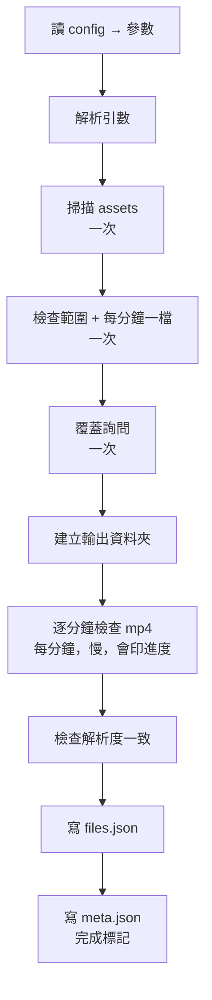

# part_1.5 — 檢查 mp4

檢查時間範圍與 assets 內的 mp4 是否合法，並寫出 `files.json` 給後面的 part 使用。

> [!IMPORTANT]
> - 這是整條流程**唯一**檢查輸入檔案的地方；後面的 part 只檢查「上一個 part 的結果」。
> - 也是**唯一**會問「要覆蓋嗎」的地方；後面的 part 一律直接覆蓋自己的資料夾。

| 項目 | 內容 |
| --- | --- |
| 腳本 | `src/part_1.5/part_1.5_main.py` |
| 上游 | 無（直接讀 assets） |
| 下游 | [part_2.0](../part_2.0/README.md)、[part_2.5](../part_2.5/README.md)、[part_3.0](../part_3.0/README.md) 等（都讀 `files.json`） |

## 用法

```bash
python src/part_1.5/part_1.5_main.py MANIFEST_JSON START_MIN END_MIN
# 例
python src/part_1.5/part_1.5_main.py manifest.json 202605211317 202605211359
```

## 輸入

| 輸入 | 說明 |
| --- | --- |
| `START_MIN` / `END_MIN` | 完整 12 位 `YYYYMMDDHHMM`（含頭尾）；必須落在 assets 內**實際掃描到**的 mp4 範圍內（小時不寫死） |
| `MANIFEST_JSON` | 由它找到 assets 資料夾、`config.json`、output（見 [tool/README.md](../tool/README.md#manifestjson)） |
| `config.json` | `part_1.5` 區塊（見下） |
| assets 內的 mp4 | `assets/{任意}/{YYYYMMDDHH}/NN{...}.mp4`，`NN` = 分鐘 `00`~`59`；**jpeg 完全忽略**（連檢查都不做） |

## 輸出

`{output}/{START}_{END}/part_1.5/`

| 檔案 | 內容 |
| --- | --- |
| `files.json` | `{"assets_dir", "frame_size": [w, h], "minutes": {分鐘: {"path"（相對 assets_dir）, "width", "height", "fps", "frames", "duration_s"}}}` |
| `meta.json` | `kind` / 範圍 / `params` / `inputs`（assets_dir）/ `frame_size` / `stats`（分鐘數、最短與最長長度）/ `created_at`；**最後才寫 = 完成標記** |

## config.json 的 `part_1.5`

沒寫的用預設值；寫了不認得的名稱就報錯。

| 參數 | 預設 | 範圍 | 意義 |
| --- | --- | --- | --- |
| `duration_s` | `60.0` | `> 0` | 每個 mp4 預期的長度（秒） |
| `tolerance_s` | `2.0` | `≥ 0` | 允許的誤差（秒）。長度必須落在 `[duration_s − tolerance_s, duration_s + tolerance_s]` |

## 檢查項目

任何一項不過 → 印 `[Error]` 並立刻結束（exit 1），**不會「記錄後繼續」**。

1. `START` / `END` 為 12 位合法時間，且 `START ≤ END`
2. 範圍落在 assets 實際有 mp4 的最早與最晚分鐘之內
3. 範圍內每一分鐘「**剛好一個**」mp4（缺檔、重複都報錯，並列出是哪些分鐘）
4. 每個 mp4：打得開、有影像串流、第一幀解得出來、長度在 `duration_s ± tolerance_s`
5. 所有 mp4 解析度相同（後面的四邊形只選一次，所有分鐘共用）

## 覆蓋

`{output}/{START}_{END}/` 已存在時會詢問：

```text
[Ask] would you like to overwrite {範圍資料夾} ? 會刪除整個資料夾後重做 [y/N]
```

| 回答 | 結果 |
| --- | --- |
| `y` | 整個範圍資料夾刪除，之後各 part 都重做 |
| `n`、直接 Enter、或沒有輸入 | 結束（exit 1） |

## 執行順序



> [!TIP]
> 網路硬碟上「逐分鐘檢查 mp4」會比較慢；進度每分鐘印一行 `(k/N) 分鐘  寬×高  fps  幀數  秒數  OK`。

## 函數表

共用函數（掃描 assets、讀 config、覆蓋詢問等）見 [tool/README.md](../tool/README.md)。

| 函數 | 輸入 → 輸出 | 呼叫時機 |
| --- | --- | --- |
| `check_range_in_ts_strs` | `start_min_str, end_min_str, ts_strs` → `None` | 一次；`ts_strs` = 掃到的所有分鐘；範圍超出就報錯並列出小時資料夾 |
| `check_each_minute_has_one_mp4` | `minute_strs, ts_to_mp4_paths_dict` → `None` | 一次；缺檔或重複 → 報錯並列出分鐘 |
| `get_minute_dict_from_mp4_path` | `mp4_path, param_dict` → `dict` | 每分鐘一次；探測 + 第一幀 + 長度檢查；回傳 `width/height/fps/frames/duration_s` |
| `check_same_frame_wh` | `ts_to_minute_dict` → `WhType` | 一次；所有分鐘解析度必須相同，回傳共同尺寸 |
| `get_files_dict_from_stage_results` | `assets_dir_path, ts_to_mp4_paths_dict, ts_to_minute_dict, frame_wh` → `dict` | 一次；`files.json` 內容 |
| `get_meta_dict_from_stage_results` | `args_ns, param_dict, files_dict` → `dict` | 一次；`meta.json` 內容 |
| `run_all_stages` | `argv_strs` → `None` | `main()` 呼叫；整個流程 |
| `main` | — → `None` | 進入點 |

> [!NOTE]
> 檔案開頭的 `get_tool_dir_str_from_argv_strs` 與 `sys.path.insert` 是固定樣板：先用標準函式庫讀 manifest.json（第一個引數）找到 tool 資料夾，再載入 `tool_main` / `tool_manifest`。
