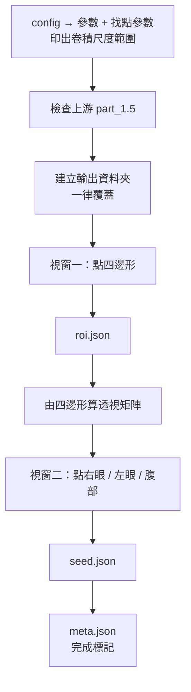

# part_2.0 — 人工輸入（兩個互動視窗）

產生後面所有 part 需要的「人工輸入」：

| 視窗 | 在哪張圖上 | 你做什麼 | 產生 |
| --- | --- | --- | --- |
| **視窗一** | mp4 第一幀（原始畫面） | 點水槽區域的四邊形（4 個角） | `roi.json` |
| **視窗二** | **拉正後**的畫面 | 挑一個時刻，依序點烏賊的右眼、左眼、腹部的大概位置 | `seed.json` |

視窗二點擊後，程式用多尺度卷積（DoG，找最深色的中心）抓回準確的圓心與半徑，並算出「腹部相對兩眼的位置」。

> [!WARNING]
> 兩個視窗**儲存成功後**才會自動關閉。沒存就關閉 / `Esc` / `Ctrl-C` → 報錯結束（exit 非 0），後面的 part 不會被執行。

| 項目 | 內容 |
| --- | --- |
| 腳本 | `src/part_2.0/part_2.0_main.py` |
| 上游 | [part_1.5](../part_1.5/README.md)（只檢查它的結果，不再檢查 mp4） |
| 下游 | [part_2.5](../part_2.5/README.md)（讀 `roi.json`）、[part_3.0](../part_3.0/README.md)（讀 `seed.json`） |
| 需要 | tkinter + Pillow（`check_tk_is_available`；macOS 沒有時：`brew install python-tk@3.12`，並用該版本的 python 建 venv、`pip install Pillow`） |

## 用法

```bash
python src/part_2.0/part_2.0_main.py MANIFEST_JSON START_MIN END_MIN
# 例
python src/part_2.0/part_2.0_main.py manifest.json 202605211317 202605211359
```

## 輸入

| 輸入 | 說明 |
| --- | --- |
| `START_MIN` / `END_MIN` | 必須與 part_1.5 相同 |
| `part_1.5/{files.json, meta.json}` | 上游結果；`meta.json` 必須存在且完成 |
| `config.json` 的 `part_2.0` | 見下 |
| `config.json` 的 `part_3.0` 中「找點」的參數 | `polarity`、`margin`、`r_min`、`r_max`、`sigma_k`、`k_z`、`z_cap`、`fit_*`… 與 part_3.0 **共用同一份**，視窗二抓回中心用的就是它們（啟動時會印出卷積的尺度範圍） |

## 輸出

`{output}/{START}_{END}/part_2.0/`

### `roi.json`

| 欄位 | 說明 |
| --- | --- |
| `kind` | `"roi_quad"` |
| `frame_size` | 原始影格 `[w, h]` |
| `reference_minute` | 四邊形取自哪個分鐘的畫面 |
| `points` | 四個頂點，順序 `左上, 右上, 右下, 左下`（`order` 欄位列出名稱） |
| `rectified_size` | 拉正後 `[w, h]` |

座標 = **原始影格像素，像素 `i` 佔 `[i, i+1)`**（UI 慣例）。

### `seed.json`

| 欄位 | 說明 |
| --- | --- |
| `minute`、`frame: 0`、`sec: 0.0` | 種子所在的分鐘（該分鐘第 0 秒） |
| `frame_size_rectified` | 拉正後 `[w, h]` |
| `clicks` | 你實際點擊的位置（`right_eye` / `left_eye` / `belly`） |
| `right_eye`、`left_eye`、`belly` | 抓回的 `[x, y, r]` |
| `fit` | 各點的擬合方法：`scale`（只有尺度）／`edge`（邊緣擬合圓）／`ray`（射線取中位數半徑） |
| `rel` | 腹部相對兩眼：`u`、`v`、`belly_r_rel`、`right_eye_r_rel`、`left_eye_r_rel`、`eye_dist_px`（定義見下） |

座標 = **拉正後影格像素，像素中心在整數**（OpenCV / numpy 慣例，與 part_3.0 / 3.5 / 4.0 相同）。

> [!NOTE]
> 兩個檔案的座標慣例不同：`roi.json` 是 UI 慣例（像素 `i` 佔 `[i, i+1)`），`seed.json` 是像素中心在整數。轉換已在程式內處理（差 0.5 px）。

### `meta.json`

`kind` / 範圍 / `params` / `blob_params` / `inputs`（part_1.5 meta 的 sha256）/ `roi_reference_minute` / `seed_minute` / `rectified_size` / `created_at`。**最後才寫 = 完成標記**。

### 腹部相對位置 `rel`

```text
m     = 兩眼中點
e_hat = (左眼 − 右眼) / d          d = 眼距
n_hat = (−e_y, e_x)
u     = (腹部 − m) · e_hat / d
v     = (腹部 − m) · n_hat / d
半徑比 = r / d
```

part_3.0 用它當**起始**值預測腹部位置，之後會隨追蹤更新（見 [part_3.0](../part_3.0/README.md#3-找腹部)）。

## config.json 的 `part_2.0`

| 參數 | 預設 | 範圍 | 意義 |
| --- | --- | --- | --- |
| `seed_search_px` | `10.0` | `1 ~ 200` | 視窗二：點擊位置周圍多少像素內尋找最深的點（拉正後像素）。點擊不必精準，只要落在該點的這個範圍內；範圍內沒有明顯的點 → 視窗提示重點 |

## 視窗操作（兩個視窗相同）

| 操作 | 作用 |
| --- | --- |
| 滑桿 / `←` `→` | 切換分鐘（每分鐘的第 0 秒）。滑桿停下約 0.15 秒才會載入影像 |
| 滾輪 | 以游標為中心放大 / 縮小 |
| 右鍵或中鍵拖曳 | 平移 |
| 左鍵點空白處 | 依序新增點 |
| 左鍵點既有的點 | 取消該點 |
| `F` | 縮放到全圖 |
| `C` | 清除全部 |
| `S` | 儲存（成功後自動關閉） |
| `Esc` | 離開（視為沒存，報錯結束） |

- 視窗二切換分鐘會**清掉已點的點**（點的位置只對該分鐘的畫面有意義）。
- 視窗一的點與時間無關，換分鐘只是為了挑一張看得清楚的畫面（四邊形存在 `reference_minute` 的影格上，所有分鐘共用）。

### 儲存時的檢查

| 視窗 | 不通過就提示（視窗不關閉） |
| --- | --- |
| 一 | 還沒點滿 4 個頂點；四邊形面積 < 整張圖的 0.1% |
| 二 | 還沒點滿 3 個點；圓心或半徑不是有限正數；兩眼重疊（距離 < 兩半徑和）；腹部與眼睛重疊 |

## 執行順序



## 函數表

共用函數見 [tool/README.md](../tool/README.md)。

### 模組層

| 函數 | 輸入 → 輸出 | 呼叫時機 |
| --- | --- | --- |
| `check_tk_is_available` | — → `None` | 一次；開視窗前 |
| `get_pil_img_from_bgr_arr` | `bgr_arr` → `PIL.Image` | 每次換分鐘（被下面兩個函數呼叫） |
| `get_first_pil_img_from_minute_str` | `ts_to_path_dict, minute_str` → `PIL.Image` | 視窗一每次載入 |
| `get_rectified_pil_img_from_minute_str` | `ts_to_path_dict, minute_str, matrix_arr, out_wh` → `PIL.Image` | 視窗二每次載入 |
| `get_area_float_from_xys` | `xys` → `float` | 視窗一儲存；鞋帶公式 |
| `is_area_valid` | `xys, wh` → `bool` | 視窗一儲存；面積 ≥ 整張 0.1% |
| `get_roi_dict_from_xys` | `start, end, frame_wh, minute_str, xys, out_wh` → `dict` | 視窗一儲存 |
| `run_save_roi_stage` | `part_dir_path, start, end, frame_wh, minute_str, xyr_list` → `str` | 視窗一的 `save_func`（每次按 `S`）；不合理丟 `ValueError`，視窗提示、不關閉 |
| `get_xyr_tuple_or_none_from_click` | `pil_img_obj, click_xy, search_px_float, blob_param_dict` → `(xyr, 方法, z) \| None` | 視窗二每次點擊；UI 座標進出；附近沒有明顯的點回傳 `None` |
| `get_seed_dict_from_slot_list` | `start, end, minute_str, rectified_wh, slot_tuple_list` → `dict` | 視窗二儲存；`slot_tuple_list = [右眼, 左眼, 腹部]`，每項 = `(抓回的 xyr, 點擊 xy, 方法)`（UI 座標）；輸出改成像素中心座標，含相對位置 |
| `run_save_seed_stage` | `part_dir_path, start, end, minute_str, rectified_wh, xyr_list` → `str` | 視窗二的 `save_func` |
| `update_window_by_raise` | `root_obj` → `None` | 開窗後一次；macOS 從終端機啟動的視窗常被藏在後面 |
| `on_poll_tick` | `root_obj, state_dict` → `None` | 視窗存活期間每 200 ms 一次；Tk 的 mainloop 會吃掉 `Ctrl-C`，所以改由 signal handler 設旗標、這裡檢查 |
| `run_picker_window_stage` | `title, minute_strs, get_img_func, name_strs, refine_func, save_func, clear_on_slide_bool, help_str` → `None` | 視窗一、二各一次；沒存就報錯 |
| `get_roi_dict_from_part_dir_path` | `part_dir_path` → `dict` | 視窗一關閉後一次；把 `roi.json` 讀回來（確認真的寫到磁碟，後面用讀回的內容） |
| `run_all_stages` | `argv_strs` → `None` | `main()` 呼叫；整個流程。內含區域函數 `save_roi_func` / `save_seed_func`（包住上面的 save 函數並記下分鐘） |
| `main` | — → `None` | 進入點 |

### `class PickerApp`（一個視窗）

滑桿切換分鐘 + 在畫面上依序點若干個點。建構參數：

| 參數 | 意義 |
| --- | --- |
| `name_strs` | 每個點的名稱（也決定點數）；有 `refine_func` 時，每次點擊會先抓回中心與半徑 |
| `get_img_func` | `(minute_str) → PIL.Image`，顯示該分鐘的畫面 |
| `refine_func` | `(PIL.Image, click_xy) → (xyr, 方法, z) \| None`；`None`（視窗一）= 不抓回 |
| `save_func` | `(minute_str, image_wh, slot_list) → 狀態訊息`；不合理丟 `ValueError`（視窗提示、不關閉） |
| `slot_list` | 與 `name_strs` 等長，每項 = `None` 或 `(xyr, 點擊 xy, 方法)`，座標為 UI 座標 |

| 方法 | 呼叫時機 |
| --- | --- |
| `init_widgets` / `init_bindings` | 建立時各一次 |
| `update_image_by_index` / `on_slide` / `on_slide_idle` / `update_slider_by_step` | 換分鐘。`on_slide` 拖曳中只更新狀態列；`on_slide_idle` 停下 150 ms 後才真的載入影像（避免拖曳時一路讀網路硬碟） |
| `to_screen_xy` / `to_image_xy` | 座標轉換（UI 座標 = 像素 `i` 佔 `[i, i+1)`） |
| `update_view_by_fit` / `update_view_by_zoom` / `on_wheel` / `on_pan_start` / `on_pan_move` | 縮放平移 |
| `draw_canvas` / `draw_image_on_canvas` / `draw_points_on_canvas` / `update_status_by_msg` | 重繪。`draw_image_on_canvas` 只裁切並縮放「看得到的那一塊」，放大很多倍也不吃記憶體；已點的點畫成圓（大小 = 抓回的半徑）+ 十字 + 名稱，視窗一再連成四邊形 |
| `get_hit_index_from_screen_xy` | `→ int \| None`；點擊是否落在既有的點上（半徑 12 螢幕像素） |
| `on_left_click` | 新增 / 取消點；有 `refine_func` 時先抓回中心 |
| `update_slots_by_clear` | 清除全部 |
| `on_save` | 呼叫 `save_func`；成功則自動關閉 |

## 常數

| 常數 | 值 | 意義 |
| --- | --- | --- |
| `HIT_RADIUS_INT` | `12` | 螢幕像素：點在既有的點這個半徑內視為「取消」 |
| `MIN_AREA_RATIO_FLOAT` | `0.001` | 四邊形面積小於整張圖 0.1% 視為退化 |
| `IMG_CACHE_SIZE_INT` | `24` | 視窗內快取最近看過的幾個分鐘的畫面 |
| `SLIDE_DELAY_MS_INT` | `150` | 滑桿停下多久才載入影像 |
| `POLL_MS_INT` | `200` | `Ctrl-C` 輪詢間隔 |

> [!NOTE]
> 檔案開頭的 `get_tool_dir_str_from_argv_strs` 與 `sys.path.insert` 是固定樣板：先用標準函式庫讀 manifest.json（第一個引數）找到 tool 資料夾，再載入 `tool_main` / `tool_manifest`。
