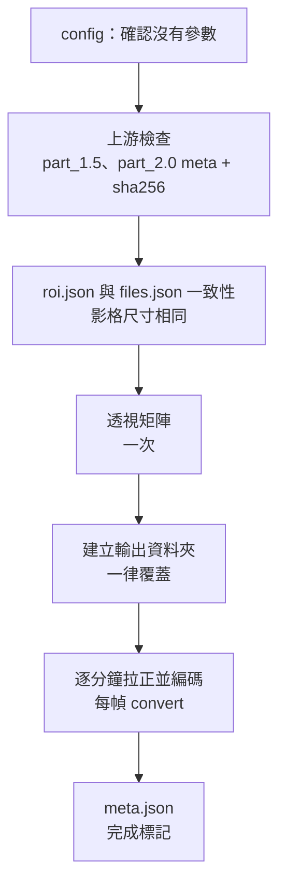

# part_2.5 — 拉正 mp4

依 [part_2.0](../part_2.0/README.md) 的四邊形，把每分鐘的 mp4 統一裁切並拉正（透視變換），輸出「一分鐘一個」拉正後的 mp4。

| 項目 | 內容 |
| --- | --- |
| 腳本 | `src/part_2.5/part_2.5_main.py` |
| 上游 | [part_1.5](../part_1.5/README.md)（`files.json`）、[part_2.0](../part_2.0/README.md)（`roi.json`） |
| 下游 | [part_3.0](../part_3.0/README.md)、[part_3.5](../part_3.5/README.md)、[part_4.0](../part_4.0/README.md)（都讀拉正後的 mp4） |

## 用法

```bash
python src/part_2.5/part_2.5_main.py MANIFEST_JSON START_MIN END_MIN
# 例
python src/part_2.5/part_2.5_main.py manifest.json 202605211317 202605211359
```

## 輸入

| 輸入 | 說明 |
| --- | --- |
| `START_MIN` / `END_MIN` | 必須與 part_1.5、part_2.0 相同 |
| `part_1.5/files.json` | 每分鐘的 mp4 路徑與影格尺寸 |
| `part_2.0/roi.json` | 四邊形；另外檢查 part_2.0 的 `meta.json` 存在，且是由**目前的** part_1.5 算出來的（sha256） |
| `config.json` | `part_2.5` **沒有參數**，寫了任何參數都會報錯 |

> [!NOTE]
> 編碼品質寫死：libx264 `crf 10`（不可用時 mpeg4 `qscale 2`）。

## 輸出

`{output}/{START}_{END}/part_2.5/`

| 檔案 | 內容 |
| --- | --- |
| `mp4s/{YYYYMMDDHHMM}.mp4` | 拉正後的 mp4，每分鐘一個；保留每一幀的時間（第一幀 = 0 秒），幀數與來源相同 |
| `meta.json` | `rectified_size`、`homography`（透視矩陣）、`roi_reference_minute`、`frame_size`、`minutes`（每分鐘的幀數 / 時長 / 編碼器）、`inputs`（part_1.5 與 part_2.0 的 meta sha256）；**最後才寫 = 完成標記** |

## 座標慣例

| 項目 | 說明 |
| --- | --- |
| `roi.json` 的座標 | 「像素 `i` 佔 `[i, i+1)`」（UI 慣例） |
| OpenCV | 「像素中心在整數 `i`」→ 拉正前先減 0.5（在 `tool_main.get_transform_from_xys` 內） |
| 拉正尺寸 | 兩組對邊長度的**平均**，不放大，調成偶數（H.264 需要） |
| 拉正之後 | 之後所有 part 都用「像素中心在整數」的座標 |

## 執行順序



> [!WARNING]
> 任何一分鐘失敗（打不開、拉正後幀數與 part_1.5 記錄不符、某幀尺寸不同…）→ 立刻報錯結束，不會留下半成品當作完成（`meta.json` 最後才寫）。

## 函數表

共用函數（`run_encode_mp4_stage`、`get_transform_from_xys`、`get_rectified_arr_from_arr` 等）見 [tool/README.md](../tool/README.md)。

| 函數 | 輸入 → 輸出 | 呼叫時機 |
| --- | --- | --- |
| `get_roi_dict_from_part_dir` | `manifest_dict, start, end` → `dict` | 一次；讀 `part_2.0/roi.json` 並檢查格式（`kind=roi_quad`、`frame_size`、4 個 `points`） |
| `check_roi_dict_matches_frame_wh` | `roi_dict, frame_wh` → `None` | 一次；`roi` 的影格尺寸必須等於 `files.json` 的 `frame_size` |
| `get_convert_func_from_matrix_arr` | `matrix_arr, out_wh, frame_wh` → `func` | 每分鐘一次；回傳區域函數 `get_converted_arr_from_bgr_arr(幀序號, 秒, bgr_arr)`，每幀呼叫，並檢查尺寸 |
| `run_minute_stage` | `ts_str, in_mp4_path, out_mp4_path, matrix_arr, out_wh, frame_wh` → `dict` | 每分鐘一次；編碼一分鐘並回傳該分鐘統計 |
| `get_meta_dict_from_stage_results` | `args_ns, manifest_dict, roi_dict, matrix_arr, out_wh, ts_to_stat_dict` → `dict` | 一次；`meta.json` 內容 |
| `run_all_stages` | `argv_strs` → `None` | `main()` 呼叫；整個流程 |
| `main` | — → `None` | 進入點 |

> [!NOTE]
> 檔案開頭的 `get_tool_dir_str_from_argv_strs` 與 `sys.path.insert` 是固定樣板：先用標準函式庫讀 manifest.json（第一個引數）找到 tool 資料夾，再載入 `tool_main` / `tool_manifest`。
