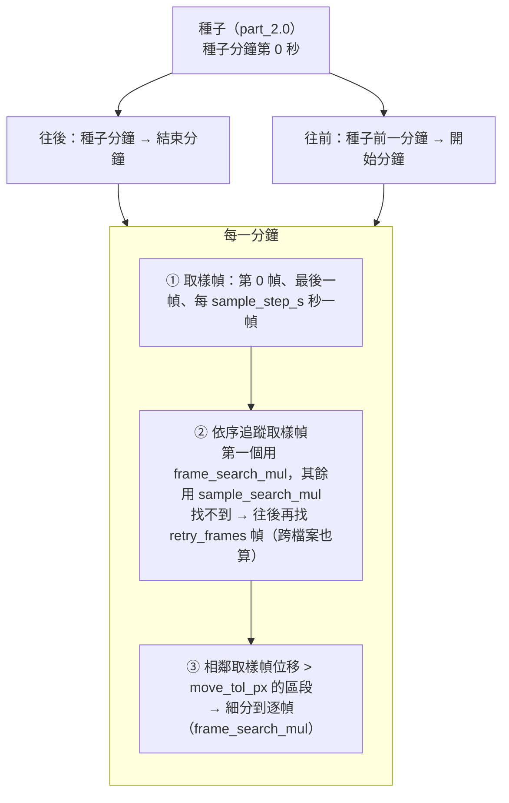

# part_3.0 — 追蹤右眼、左眼

在 [part_2.5](../part_2.5/README.md) 拉正後的 mp4 上，從你在 [part_2.0](../part_2.0/README.md) 點的種子出發，逐分鐘、逐幀追蹤烏賊的**右眼、左眼**。
腹部由 [part_4.0](../part_4.0/README.md) 另外找（以這裡的眼睛結果為基準）。

| 項目 | 內容 |
| --- | --- |
| 腳本 | `src/part_3.0/part_3.0_main.py` |
| 上游 | part_2.5（拉正 mp4）、part_2.0（`seed.json`） |
| 下游 | [part_3.5](../part_3.5/README.md)（畫眼睛檢查）、[part_4.0](../part_4.0/README.md)（找腹部，需要 `status = complete`） |
| 特色 | **邊跑邊寫** `meta.json`：參數要靠看結果調，所以失敗 / 中斷時也會留下已追蹤的部分，part_3.5 照樣能畫出來 |

## 用法

```bash
python src/part_3.0/part_3.0_main.py MANIFEST_JSON START_MIN END_MIN
# 例
python src/part_3.0/part_3.0_main.py manifest.json 202605211317 202605211359
```

## 追蹤策略（一句話版）

> 下一個位置一律**從上一個位置附近**找；找不到先往後再找 `retry_frames` 幀（跨檔案也算），都找不到才報錯，不會跑去很遠的地方「湊」。



### 分鐘與分鐘之間：跳檔案就像同一分鐘裡

整段影片當成**一條連續的幀序列**：換檔案不做任何特別的檢查、不套用額外的限制，找不到時也報一樣的錯。唯一的差別是「下一幀」在另一個檔案裡：

| 方向 | 起點（上一個位置） | 這一分鐘第一個要找的幀 |
| --- | --- | --- |
| 往後（forward） | 前一分鐘最後一個追蹤到的眼睛 | 本分鐘第 0 幀（相鄰幀，搜尋範圍 `frame_search_mul`） |
| 往前（backward） | 後一分鐘最早一個追蹤到的眼睛 | 本分鐘最後一幀（同上） |
| 種子分鐘 | 你在 part_2.0 點的種子 | 種子分鐘第 0 幀（`kind = seed`） |
| 種子前一分鐘 | **種子分鐘最早一個追蹤到的眼睛**（已追蹤到的，不是點擊） | 種子前一分鐘最後一幀 |

> [!NOTE]
> 以前在分鐘交界有「逐眼 gate + 事後檢查」（`boundary_search_px` / `boundary_tol_px`），已經移除。原因：畫面本身會**整數像素抖動**（下一節），固定的像素門檻很容易把正常的抖動誤判成追錯；而真的追錯時，後面的幀本來就會因為找不到而報錯。

#### 為什麼「完全沒動」也會差好幾個像素

兩眼看起來沒動，畫面本身其實會**以整數像素抖動**：在真實影片（`202605211329`）上量，眼睛的 y 在 60、61、62 之間來回跳，一分鐘內的範圍就有 2～4px，而且右眼、左眼各自獨立地跳（不是整個畫面一起平移）。
眼睛只有 2～3px 寬，DoG 的峰值、邊緣擬合的圓心都跟著這個抖動，所以前一分鐘最後一幀與下一分鐘第 0 幀相差 3～4px 是正常的，不代表追錯。

#### 找不到時：往後再找幾幀（`retry_frames`）

某一個要找的幀（取樣幀或細分的逐幀）找不到兩眼時，**先不報錯**，依追蹤方向再往後找 `retry_frames` 幀（預設 9，也就是「下一幀找不到 → 找 +2 幀、+3 幀 … 直到 +10 幀」）。**跨到另一個檔案也算加一幀**：

- 找到了：記錄在**找到的那一幀**（`kind = retry`、`retry_k` = 比原本要找的幀往後多幾幀），之後從這個位置繼續追。中間沒找到的幀沒有 entry，下游（part_3.5 / part_4.5）會沿用上一筆畫出來。
- 取樣幀往後找的時候，如果越過了檔案邊界，找到的 entry 會放進**另一個分鐘**的 json（它會是那一分鐘的第一筆，所以那一分鐘的 json 不一定從第 0 幀開始）。
- 細分的逐幀往後找的時候，到達這一段的終點（已經找到的取樣幀）就算找到，這一段結束。
- 全部（原本那一幀 + `retry_frames` 幀）都找不到，才報錯；錯誤訊息會寫出「往後再找了幾幀、有沒有跨檔案」。`retry_frames = 0` 就是關閉重試。
- 往後再找也到不了的地方（超過範圍的第一個分鐘之前 / 最後一個分鐘之後）視為沒有幀，不再往下試。

### 一分鐘之內

1. **取樣幀**：第 0 幀、最後一幀、以及最接近 `sample_step_s, 2·sample_step_s, …` 秒的幀。
2. **追蹤取樣幀**：依方向的順序（forward 由前到後、backward 由後到前）一幀一幀找。每一幀用上一個取樣幀的位置當中心，搜尋範圍 `±(sample_search_mul + 0.5)·d`（這一分鐘的第一個取樣幀是上一個位置的相鄰幀，用 `frame_search_mul`）。找不到時依上面的規則往後再找。
3. **細分**：相鄰兩個取樣幀之間，眼睛位移（兩眼取較大者）`> move_tol_px` 且中間還有幀 → 這一段逐幀追蹤（`kind = frame`，範圍 `frame_search_mul`），從這一段的起點往終點走。沒動的段落不細分，省時間。
4. 時間字串不可重複（part_4.0、part_5.0 的前提），否則報錯。

## 一幀怎麼找（偵測）

### 1. 找候選點：DoG 多尺度卷積

```text
灰階圖 →（polarity = bright 時反相，使目標都是「暗的」）
   → 以 σ₀ < σ₁ < … < σₙ 做高斯模糊（影格邊緣 margin 內不參與）
   → 相鄰兩級相減 = DoG 響應
   → 每層 DoG 以該搜尋範圍（含外擴、不含 margin）內的中位數與 MAD 換成 z 分數（噪聲下限 0.25）
   → 在 (x, y, 尺度) 三維中找局部極大值，且 z > k_z
   → 取 z 最大的前 max_cand 個；位置用 3×3 的 z 加權重心細化；半徑 r = √2·σ
```

#### 卷積的大小界線

> [!IMPORTANT]
> 能偵測的圓半徑由 `config.json` 的 **`r_min` / `r_max` / `sigma_k`** 決定（part_2.0、part_3.0、part_4.0 共用同一套公式，各自讀自己的 config 區塊）。啟動時會印出實際的尺度，例如：
>
> `找點的卷積（DoG）共 9 層（用 10 個高斯模糊 σ = 0.60 ~ 11.67 相鄰相減），各層偵測的圓半徑 ≈ √2·σ = 1.0 ~ 14.0 px`

一層 DoG = 相鄰兩個高斯模糊相減，這一層「最敏感」的圓半徑 `r ≈ √2·σ_c`，`σ_c` 是這兩個 σ 的幾何平均。尺度由下面的公式排出來，使**各層中心剛好涵蓋 `[r_min, r_max]`**：

| 量 | 公式 | 預設值下 |
| --- | --- | --- |
| 層數 `L` | `max(3, ⌈ln(r_max / r_min) / ln(sigma_k)⌉ + 1)` | 9 |
| 相鄰層半徑比 | `(r_max / r_min)^(1/(L−1))`，≤ `sigma_k` | 1.39 |
| 第 `i` 層偵測半徑 | `r_min · 比^i`（`i = 0 … L−1`） | 1.0 ~ 14.0 px |
| 高斯模糊 σ（共 `L+1` 個） | `r_min/√2 / √比 · 比^i`（`i = 0 … L`） | 0.60 ~ 11.67（10 個） |
| 搜尋裁切的外擴 | `⌈3·σ_max⌉` | 36 px（讓邊界附近的模糊不失真；OpenCV 依 σ 自動決定核大小） |

- 至少 3 層（三維極大值需要）；`r_max` 必須大於 `r_min`，否則報錯。
- 太小的點（< `r_min`）與太大的塊（> `r_max`）偵測不到。要涵蓋更大的目標，只要調 `r_max`，不必改程式。
- 眼睛另外還有「相對於上一個半徑」的半徑範圍：`eye_r_ratio`（見下）。

### 2. 選兩隻眼睛

從候選點中取半徑在 `eye_r_ratio × 上一個眼睛平均半徑` 內的，兩兩配對，**全部通過**才算合法配對：

| 條件 | 參數 |
| --- | --- |
| 兩點的 z 都 ≥ `eye_k_z`（眼睛的門檻比 `k_z` 嚴），**且** ≥ `eye_z_ratio_min × 上一幀兩眼較弱那隻的 z` | `eye_k_z`、`eye_z_ratio_min` |
| 兩點半徑比 ≤ `size_ratio_max` | `size_ratio_max` |
| 兩點不重疊：距離 ≥ `eye_gap × (r₁ + r₂)` | `eye_gap` |
| 兩點距離與**種子的眼距** `ref.d` 相差 ≤ `spacing_tol × ref.d`（不是上一幀的眼距，見下） | `spacing_tol` |

合法配對之間用分數選最好的：

```text
score = mean( min(z_右, z_cap), min(z_左, z_cap) )     ← 對比越強越好
        − 2 · ln( 較大半徑 / 較小半徑 )                   ← 兩眼大小越接近越好
        − move_weight · cost / d                          ← 離上一個位置越近越好
```

- `cost` = 兩眼離「上一個位置」的平均位移（右 / 左的指派取總位移較小的那種）。
- 右眼 / 左眼的身份由「離上一個右眼 / 左眼比較近」決定。

> [!TIP]
> **z 的飽和（`z_cap`）**：z 在 `z_cap` 被截斷後才進分數。`z_cap` 太小（舊預設 12）時，真正的眼睛與一個「比較淡、但也很顯著」的假點得分相同，這時只剩「離上一個位置近」這一項，就會被假點吸走。現在預設 **200**，讓對比較強的眼睛能贏過假點；若畫面上有極亮極暗的雜訊塊會搶走分數，再調小。

選定之後用**邊緣擬合**精修圓心與半徑（見下「擬合」）。

### 3. 為什麼眼睛不會被「帶走」

真實影片（`202605211329`）曾經發生過：約 30 秒時右眼跑到左眼旁邊的雜訊點，之後整條追蹤都歪掉。原因有三個，現在都處理了：

| 原因 | 處理 |
| --- | --- |
| DoG 的半徑只有幾個離散的層（約 1.0、1.4、1.9、2.7、3.7），**很小的眼睛半徑會在相鄰層之間跳**（右眼 1.0、左眼 2.7 → 比值 2.7）。舊的 `size_ratio_max = 1.8` 與 `eye_r_ratio = [0.5, 2.0]` 把真正的一對眼睛整對丟掉 | `size_ratio_max` 預設 `3.0`、`eye_r_ratio` 預設 `[0.3, 3.0]`。半徑只是粗略的過濾，真正的區分靠 z 與位置；半徑比的差異仍會在分數裡被扣（`−2·ln(比值)`） |
| 真的一對被丟掉後，退而求其次選到 z 只有 7 左右的雜訊點（真眼睛 z 約 60～80），只要 ≥ `eye_k_z`（6）就合格 | 新增 `eye_z_ratio_min`：這對眼睛較弱的 z 必須 ≥ 上一幀的 `eye_z_ratio_min` 倍。雜訊點因此直接不合格，寧可報錯停下來，也不悄悄追錯 |
| 一旦選錯，「上一幀的眼距」也跟著變小，下一幀真正的眼睛因為「眼距差太多」被擋掉，錯誤就鎖死 | 眼距的檢查改用**種子的眼距 `ref.d`**（整個追蹤過程不變），搜尋範圍與分數仍用上一幀的眼距 `d` |

> [!NOTE]
> 先前版本曾在腹部沒高信心時把左右眼標籤對調再試一次（`labels_swapped`）。真實影片中腹部會暫時變淡，對調後的鏡射位置恰好有雜訊點就會被誤採用，且之後的指派跟著上一幀走，標籤就整段反了，所以**已移除**。左右眼的標籤只由「離上一個位置較近」決定。腹部現在由 part_4.0 處理，不再影響眼睛。

### 4. 擬合（圓心與半徑）

在平滑後的影像上，由圓心向外取 `fit_rays` 條射線，找每條射線上亮度梯度最大處（半徑上限 `fit_rmax_mul × r`，並限制在兩眼間距的 0.85 內）。

| `fit` 欄位 | 意義 |
| --- | --- |
| `edge` | 邊緣點擬合圓成功（圓心與半徑都由邊緣決定） |
| `ray` | 邊緣擬合不合理，圓心不動、半徑取射線中位數 |
| `scale` | 梯度不足，直接用 DoG 的尺度半徑 |

## 輸入

| 輸入 | 說明 |
| --- | --- |
| `part_2.5/mp4s/{分鐘}.mp4` | 拉正後的 mp4，範圍內每分鐘都要有 |
| `part_2.5/meta.json` | 並檢查它是由**目前的** part_2.0 算出來的（sha256） |
| `part_2.0/seed.json` | 種子：`right_eye` / `left_eye`；種子分鐘必須在範圍內。只用來開始：眼睛的起始位置（腹部與 `rel` 由 part_4.0 使用） |
| `config.json` 的 `part_3.0` | 見下 |

## 輸出

`{output}/{START}_{END}/part_3.0/`

### `{分鐘}.json`

每分鐘一個檔，內容是 entry 的陣列（依 `frame` 排序）。座標 = 拉正後影格像素，**像素中心在整數**。

| 欄位 | 說明 |
| --- | --- |
| `time` / `minute` / `frame` / `sec` | 時間字串 `YYYY-MM-DDTHH:MM:SS.mmm`、分鐘、幀序號、該幀在這一分鐘內的秒數 |
| `kind` | `seed`（種子分鐘第 0 幀）、`sample`（取樣幀）、`frame`（細分的逐幀）、`retry`（原本要找的幀找不到，往後再找才找到的） |
| `retry_k` | 往後多找了幾幀才找到（`kind = retry` 時 ≥ 1，其他為 0） |
| `right_eye` / `right_eye_r` | 右眼 `[x, y]` 與半徑 |
| `left_eye` / `left_eye_r` | 左眼 |
| `eye_z` | 這一幀兩眼較弱那隻的 z（下一幀的 `eye_z_ratio_min` 以它為基準） |
| `eye_score` | 眼睛配對的分數 |
| `fit` | `{right_eye, left_eye}` 各自的擬合方法 |

### `meta.json`（邊跑邊寫）

| 欄位 | 說明 |
| --- | --- |
| `status` | `running` / `complete` / `failed` / `interrupted` |
| `params` | 這次實際使用的參數（含預設） |
| `inputs` | part_2.5 與 part_2.0 的 meta sha256 |
| `seed` | `{minute, frame}` |
| `minutes` | 每個已完成（或失敗那分鐘失敗前）的分鐘：`{complete, entries, by_kind}` |
| `pending` | 還沒做的分鐘 |
| `failed` | 失敗資訊（見下）；沒失敗時為 `null` |
| `updated_at` | 最後更新時間 |

每完成一個分鐘就更新一次 `meta.json`。下游的檢查：part_3.5 接受任何 status（畫到哪算到哪）；part_4.0 **只接受 `complete`**（part_4.5、part_5.0 也間接需要它）。

## 失敗時

任何一幀（含往後再找的 `retry_frames` 幀）都找不到合理的兩眼、或你按了 Ctrl-C：

1. 失敗那一分鐘「失敗前」已追蹤的幀會存成該分鐘的 `{分鐘}.json`（`complete: false`）。
2. `meta.json` 的 `status` 改成 `failed`（Ctrl-C 為 `interrupted`），並寫入 `failed`：

| `failed` 欄位 | 說明 |
| --- | --- |
| `minute` / `order` | 失敗的分鐘、方向（`forward` / `backward`） |
| `type` / `error` | 例外類型與訊息 |
| `frame` | **開始失敗的那一幀**的序號：第 `minute` 分鐘的這一幀（時間 = 錯誤訊息裡的「第 b 秒」）；Ctrl-C 為 `null` |
| `last_good` | 最後一個好的位置：`right_eye`、`right_eye_r`、`left_eye`、`left_eye_r`、`search_box`（找不到時的搜尋範圍） |

3. 程式印出 `[Warn]` 與可以直接執行的 part_3.5 指令，結束（exit 1；Ctrl-C 為 130）。

假設在 a 分鐘 b 秒開始失敗：part_3.5 仍會輸出第 a 分鐘的影片，但**從第 b 秒（失敗那一幀）起不畫圓**，只在左上角標 `FAILED`。往前追蹤（backward）失敗時相反：從第 b 秒**往前**（更早的幀）不畫。

## config.json 的 `part_3.0`

沒寫的用預設值；寫了不認得的名稱就報錯；型別與範圍不合會指出是哪個參數。

### 找點（與 part_2.0 共用；part_4.0 有自己的一份）

| 參數 | 預設 | 範圍 | 意義 |
| --- | --- | --- | --- |
| `polarity` | `"dark"` | `dark` / `bright` | 目標比背景暗（`dark`）或亮（`bright`） |
| `margin` | `0.10` | `[0, 0.4)` | 影格四周忽略的比例（× 短邊）；邊緣的卷積不可靠 |
| `r_min` | `1.0` | `> 0` | 可偵測的最小圓半徑（拉正後像素） |
| `r_max` | `14.0` | `> r_min` | 可偵測的最大圓半徑 |
| `sigma_k` | `1.4` | `> 1` | 相鄰兩個卷積尺度 σ 的比值上限；越小尺度越密、越慢、半徑越準 |
| `k_z` | `2.5` | `> 0` | 候選點的 z 下限 |
| `max_cand` | `12` | `3 ~ 200` | 每個搜尋範圍最多保留幾個候選（依 z 由大到小） |
| `z_cap` | `200.0` | `> 0` | z 進入分數前的上限（見上「z 的飽和」） |
| `fit_rays` | `24` | `8 ~ 360` | 擬合時的射線數 |
| `fit_rmax_mul` | `2.2` | `> 1` | 擬合時射線最遠到 `fit_rmax_mul × r` |
| `fit_smooth` | `0.6` | `> 0` | 擬合前的高斯模糊 σ |

### 追蹤

| 參數 | 預設 | 範圍 | 意義 |
| --- | --- | --- | --- |
| `sample_step_s` | `10.0` | `> 0` | 取樣幀的間隔（秒） |
| `move_tol_px` | `1.5` | `> 0` | 相鄰取樣幀位移超過它就細分到逐幀 |
| `sample_search_mul` | `3.0` | `> 0` | 取樣幀的搜尋範圍 = 上一個位置 ± `(mul + 0.5)·d` |
| `frame_search_mul` | `1.0` | `> 0` | 細分的逐幀、以及每個分鐘第一個取樣幀（與上一個位置相鄰）的搜尋範圍倍數 |
| `spacing_tol` | `0.5` | `0 ~ 5` | 眼距允許與**種子的眼距**相差 `spacing_tol × 種子眼距` |
| `retry_frames` | `9` | `0 ~ 100`（整數） | 某一幀找不到時，依追蹤方向再往後找的幀數（跨檔案也算）；全部找不到才報錯。`0` = 不重試 |
| `move_weight` | `4.0` | `≥ 0` | 打分時「離上一個位置的位移 / d」的權重；越大越黏著上一個位置 |
| `eye_r_ratio` | `[0.3, 3.0]` | `[小, 大]`，小 < 大，皆 > 0 | 眼睛半徑相對上一個眼睛平均半徑的範圍 |
| `size_ratio_max` | `3.0` | `≥ 1` | 兩眼半徑比上限（DoG 半徑是離散的層，小眼睛會在相鄰層間跳，所以不宜太緊） |
| `eye_gap` | `1.2` | `≥ 0` | 兩眼距離至少 = `eye_gap × (r₁ + r₂)` |
| `eye_k_z` | `7.0` | `> 0` | 眼睛候選的 z 下限（比 `k_z` 嚴） |
| `eye_z_ratio_min` | `0.2` | `0 ~ 1` | 這一對眼睛較弱的 z 必須 ≥ 上一幀較弱 z 的這個倍數；`0` = 不檢查。擋掉「真眼睛被丟掉後退而求其次的雜訊點」 |

### 調參對照

| 現象 | 先看哪個參數 |
| --- | --- |
| 找不到眼睛（`找不到兩眼`） | `eye_k_z` / `k_z` 太高、`eye_z_ratio_min` 太大（眼睛真的變淡）、`spacing_tol` 太小、`r_min` / `r_max` 沒涵蓋眼睛大小、`eye_r_ratio` / `size_ratio_max` 太窄 |
| 圈到不是眼睛的地方 | 提高 `move_weight`、降低 `sample_step_s`（取樣更密，每次移動更小）、確認 `z_cap` 沒太小 |
| 眼睛短暫被遮住 / 糊掉就報錯 | 調大 `retry_frames`（往後多找幾幀） |
| 眼睛動很快追不上 | 增大 `sample_search_mul` / `frame_search_mul`，降低 `move_tol_px` |
| 太慢 | 增大 `sigma_k`（尺度少）、增大 `sample_step_s`、減小 `max_cand` |

## 函數表

共用函數（`get_seed_dict_from_part_dir`、`get_xyrz_list_from_img_arr`、`get_fit_xyr_method_tuple_from_img_arr` 等）見 [tool/README.md](../tool/README.md)。

### 偵測（一幀）

| 函數 | 輸入 → 輸出 | 呼叫時機 |
| --- | --- | --- |
| `get_state_dict_from_xyrs` | `right_xyr, left_xyr, ref_dict=None, z_float=0.0` → `dict` | 種子時一次；`state = {right, left, d, ref, z}`（`d` = 上一幀眼距、`ref = {d}` = 種子的眼距，整個追蹤不變、`z` = 上一幀兩眼較弱的 z） |
| `get_state_dict_from_entry_dict` | `entry_dict, ref_dict=None` → `dict` | 每個 entry 之後；下一個位置的搜尋起點（含該幀的 `eye_z`；`ref` 沿用） |
| `get_search_xyxy_from_state_dict` | `state_dict, mul_float, img_wh` → `xyxy` | 每次找眼睛；搜尋範圍（兩眼中點 ± `(mul + 0.5)·d`，裁到影格內） |
| `is_eye_pair_valid` | `xyrz_1, xyrz_2, state_dict, param_dict` → `bool` | 每對候選；z（含相對上一幀）、半徑比、不重疊、與種子眼距 `ref.d` 的條件 |
| `get_assigned_tuple_from_xyrzs` | `xyrz_1, xyrz_2, state_dict` → `(右, 左, cost)` | 每對合法候選；依離上一個位置較近指派左右 |
| `get_pair_score_float` | `right_xyrz, left_xyrz, cost_float, state_dict, param_dict` → `float` | 每對合法候選；打分（見上） |
| `get_eye_dict_or_none_from_img_arr` | `img_arr, state_dict, mul_float, param_dict` → `dict \| None` | 每一幀；半徑過濾 → 配對 → 打分 → 擬合；找不到回傳 `None` |
| `get_detect_dict_or_none_from_gray_arr` | `gray_arr, state_dict, mul_float, param_dict` → `dict \| None` | 每一幀；回傳 `get_eye_dict_or_none_from_img_arr` 的結果 |
| `get_entry_dict_from_detect_dict` | `ctx_dict, pos_int, index_int, kind_str, k_int, detect_dict` → `dict` | 每一幀；寫進 `{分鐘}.json` 的 entry（`pos_int` = 該幀所屬的分鐘在範圍內的順序，可以是另一個檔案） |

### 取樣、細分、往後再找

`ctx_dict` = `{minute_strs, frame_count_ints, in_dir_path, param_dict, sec_dict}`：整段範圍共用的資訊（每分鐘幀數來自 part_2.5 的 `meta.json`）。幀以 `(pos_int, index_int)` 表示：第幾個分鐘、該分鐘的第幾幀。

| 函數 | 輸入 → 輸出 | 呼叫時機 |
| --- | --- | --- |
| `get_sec_floats_from_ctx_dict` | `ctx_dict, pos_int` → `list[float]` | 需要某分鐘每幀的秒數時；每分鐘快取 |
| `get_pos_index_tuple_or_none` | `frame_count_ints, pos_int, index_int, delta_int` → `(pos, index) \| None` | 算「往後 / 往前再 k 幀」；一幀一幀走，跨檔案就換分鐘；超出範圍回傳 `None` |
| `get_candidate_tuple_list` | `ctx_dict, pos_int, index_int, dir_int, limit_index_int=None` → `list[(pos, index)]` | 每次找眼睛；原本的幀 + 往後最多 `retry_frames` 幀；`limit_index_int`：細分時到終點為止 |
| `update_gray_dict_from_key_tuples` | `ctx_dict, gray_dict, key_tuples` → `None` | 需要解碼某些幀時；每個 mp4 只解碼一次（到最大的幀序號為止），跨檔案的幀等需要才解碼 |
| `get_found_tuple_or_none_and_candidate_list` | `ctx_dict, gray_dict, pos_int, index_int, dir_int, state_dict, mul_float, limit_index_int=None` → `((k, pos, index, detect) \| None, 候選清單)` | 每個要找的幀；依序試候選，第一個找到的就用 |
| `get_sample_index_ints_from_sec_floats` | `sec_floats, step_float` → `list[int]` | 每分鐘一次；取樣幀序號 |
| `get_dist_float_from_entry_dicts` | `entry_a, entry_b` → `float` | 每對相鄰 entry；兩眼位移取較大者 |
| `get_last_good_dict_from_state_dict` | `state_dict, mul_float` → `dict` | 失敗時；最後一個好的位置與搜尋範圍 |
| `get_not_found_msg_str` | `ctx_dict, pos_int, index_int, state_dict, mul_float, candidate_list` → `str` | 找不到時；說明找了哪裡、往後再找了幾幀（有沒有跨檔案）、該調哪些參數 |
| `run_sample_stage` | `ctx_dict, pos_int, order_str, state_dict, seed_bool, entry_dict_list` → `dict \| None` | 每分鐘一次；追蹤取樣幀。若往後再找時跨到另一個檔案，回傳那一筆 entry（交給下一個分鐘當第一筆） |
| `get_segment_tuple_list_from_entry_dict_list` | `entry_dict_list, move_tol_px_float` → `list[(a, b)]` | 每分鐘一次；有動的區段 |
| `run_subdivide_stage` | `ctx_dict, pos_int, segment_tuple_list, ref_dict, entry_dict_list` → `None` | 每分鐘一次；有動的區段逐幀追蹤；到達區段終點就算完成 |
| `run_minute_stage` | `ctx_dict, pos_int, order_str, state_dict, seed_bool, entry_dict_list` → `dict \| None` | 每分鐘一次；取樣 → 細分 → 排序 → 檢查時間不重複；回傳跨到另一個檔案的 entry（沒有則 `None`） |

### 輸出與失敗

| 函數 | 輸入 → 輸出 | 呼叫時機 |
| --- | --- | --- |
| `get_stat_dict_from_entry_dict_list` | `entry_dict_list, complete_bool` → `dict` | 每分鐘；`meta.json` 的 `minutes` |
| `get_failed_dict_from_error` | `error_obj, ts_str, order_str` → `dict` | 失敗時；`meta.json` 的 `failed` |
| `get_meta_dict_from_stage_results` | `args_ns, manifest_dict, param_dict, seed_dict, ts_to_stat_dict, minute_strs, status_str, failed_dict` → `dict` | 每次存進度；`meta.json` 內容 |
| `run_save_progress_stage` | 同上 + `out_dir_path` → `None` | 開始、每完成一分鐘、結束時 |
| `run_save_failure_stage` | `error_obj, ts_str, order_str, entry_dict_list, out_dir_path, …` → `None` | 失敗 / 中斷時；存下失敗前的部分並印出 part_3.5 指令 |
| `class TrackError(ValueError)` | `msg_str, frame_int, last_good_dict` | 找不到眼睛（含往後再找都找不到）時丟出，帶著開始失敗的幀與 `last_good` |
| `run_all_stages` | `argv_strs` → `None` | `main()` 呼叫；整個流程 |
| `main` | — → `None` | 進入點 |

> [!NOTE]
> 檔案開頭的 `get_tool_dir_str_from_argv_strs` 與 `sys.path.insert` 是固定樣板：先用標準函式庫讀 manifest.json（第一個引數）找到 tool 資料夾，再載入 `tool_main` / `tool_manifest`。
