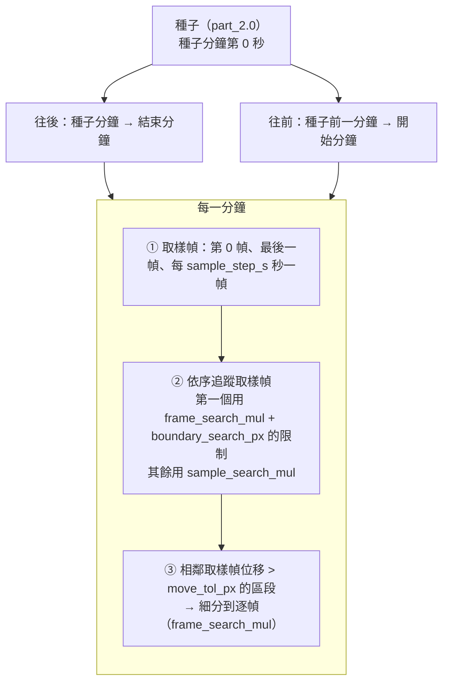

# part_3.0 — 追蹤右眼、左眼、腹部

在 [part_2.5](../part_2.5/README.md) 拉正後的 mp4 上，從你在 [part_2.0](../part_2.0/README.md) 點的種子出發，逐分鐘、逐幀追蹤烏賊的**右眼、左眼、腹部**。

| 項目 | 內容 |
| --- | --- |
| 腳本 | `src/part_3.0/part_3.0_main.py` |
| 上游 | part_2.5（拉正 mp4）、part_2.0（`seed.json`） |
| 下游 | [part_3.5](../part_3.5/README.md)（畫圓檢查）、[part_4.0](../part_4.0/README.md)（亮度，需要 `status = complete`） |
| 特色 | **邊跑邊寫** `meta.json`：參數要靠看結果調，所以失敗 / 中斷時也會留下已追蹤的部分，part_3.5 照樣能畫出來 |

## 用法

```bash
python src/part_3.0/part_3.0_main.py MANIFEST_JSON START_MIN END_MIN
# 例
python src/part_3.0/part_3.0_main.py manifest.json 202605211317 202605211359
```

## 追蹤策略（一句話版）

> 下一個位置一律**從上一個位置附近**找，找不到就報錯，不會跑去很遠的地方「湊」。



### 分鐘與分鐘之間（邊界）

兩個相鄰分鐘的交界（前一分鐘的最後一幀 ↔ 後一分鐘的第 0 幀）畫面幾乎相同，所以：

| 方向 | 起點（上一個位置） | 這一分鐘第一個要找的幀 |
| --- | --- | --- |
| 往後（forward） | 前一分鐘的**最後一幀**的眼睛 | 本分鐘第 0 幀 |
| 往前（backward） | 後一分鐘的**第 0 幀**的眼睛 | 本分鐘最後一幀 |
| 種子分鐘 | 你在 part_2.0 點的種子 | 種子分鐘第 0 幀（`kind = seed`） |
| 種子前一分鐘 | **種子分鐘的第 0 幀**（已追蹤到的，不是點擊） | 種子前一分鐘最後一幀 |

這一個「邊界幀」有兩道限制（其餘幀不套用 gate）：

1. **搜尋範圍**：只在上一個位置的 `±(frame_search_mul + 0.5)·d` 內找（`d` = 眼距）。
2. **逐眼 gate**：右眼必須離上一個右眼 `≤ boundary_search_px`、左眼必須離上一個左眼 `≤ boundary_search_px`（單位：拉正後像素）。不在 gate 內的候選直接丟掉。

找到之後再做一次**事後檢查**：兩眼離上一個位置的最大位移必須 `≤ boundary_tol_px`，否則報錯（`TrackError`）。

> [!NOTE]
> `boundary_search_px`（找之前，限制候選）比 `boundary_tol_px`（找完之後，驗收擬合後的位置）寬鬆；兩者都是為了確保「前一分鐘 60 秒」與「下一分鐘 0 秒」的位置不會差很多。

### 一分鐘之內

1. **取樣幀**：第 0 幀、最後一幀、以及最接近 `sample_step_s, 2·sample_step_s, …` 秒的幀。
2. **追蹤取樣幀**：依方向的順序（forward 由前到後、backward 由後到前）一幀一幀找。每一幀用上一個取樣幀的位置當中心，搜尋範圍 `±(sample_search_mul + 0.5)·d`（邊界幀例外，見上）。
3. **細分**：相鄰兩個取樣幀之間，眼睛位移（兩眼取較大者）`> move_tol_px` 且中間還有幀 → 這一段逐幀追蹤（`kind = frame`，範圍 `frame_search_mul`），從這一段的起點往終點走。沒動的段落不細分，省時間。
4. 時間字串不可重複（part_4.0 的前提），否則報錯。

## 一幀怎麼找（偵測）

### 1. 找候選點：DoG 多尺度卷積

```text
灰階圖 →（polarity = bright 時反相，使目標都是「暗的」）
   → 以 σ₀ < σ₁ < … < σₙ 做高斯模糊（影格邊緣 margin 內不參與）
   → 相鄰兩級相減 = DoG 響應
   → 每層 DoG 以該搜尋範圍（含外擴、不含 margin）內的中位數與 MAD 換成 z 分數（噪聲下限 0.25）
   → 在 (x, y, 尺度) 三維中找局部極大值，且 z > k_z
   → 取 z 最大的前 max_cand 個；位置用 3×3 的 z 加權重心細化；半徑 r = √2·σ
```

#### 卷積的大小界線

> [!IMPORTANT]
> 能偵測的圓半徑由 `config.json` 的 **`r_min` / `r_max` / `sigma_k`** 決定（part_2.0 與 part_3.0 共用）。啟動時會印出實際的尺度，例如：
>
> `找點的卷積（DoG）共 9 層（用 10 個高斯模糊 σ = 0.60 ~ 11.67 相鄰相減），各層偵測的圓半徑 ≈ √2·σ = 1.0 ~ 14.0 px`

一層 DoG = 相鄰兩個高斯模糊相減，這一層「最敏感」的圓半徑 `r ≈ √2·σ_c`，`σ_c` 是這兩個 σ 的幾何平均。尺度由下面的公式排出來，使**各層中心剛好涵蓋 `[r_min, r_max]`**：

| 量 | 公式 | 預設值下 |
| --- | --- | --- |
| 層數 `L` | `max(3, ⌈ln(r_max / r_min) / ln(sigma_k)⌉ + 1)` | 9 |
| 相鄰層半徑比 | `(r_max / r_min)^(1/(L−1))`，≤ `sigma_k` | 1.39 |
| 第 `i` 層偵測半徑 | `r_min · 比^i`（`i = 0 … L−1`） | 1.0 ~ 14.0 px |
| 高斯模糊 σ（共 `L+1` 個） | `r_min/√2 / √比 · 比^i`（`i = 0 … L`） | 0.60 ~ 11.67（10 個） |
| 搜尋裁切的外擴 | `⌈3·σ_max⌉` | 36 px（讓邊界附近的模糊不失真；OpenCV 依 σ 自動決定核大小） |

- 至少 3 層（三維極大值需要）；`r_max` 必須大於 `r_min`，否則報錯。
- 太小的點（< `r_min`）與太大的塊（> `r_max`）偵測不到。要涵蓋更大的目標，只要調 `r_max`，不必改程式。
- 眼睛與腹部另外還有「相對於上一個半徑」的半徑範圍：`eye_r_ratio`、`body_r_ratio`（見下）。

### 2. 選兩隻眼睛

從候選點中取半徑在 `eye_r_ratio × 上一個眼睛平均半徑` 內的，兩兩配對，**全部通過**才算合法配對：

| 條件 | 參數 |
| --- | --- |
| 兩點的 z 都 ≥ `eye_k_z`（眼睛的門檻比 `k_z` 嚴），**且** ≥ `eye_z_ratio_min × 上一幀兩眼較弱那隻的 z` | `eye_k_z`、`eye_z_ratio_min` |
| 兩點半徑比 ≤ `size_ratio_max` | `size_ratio_max` |
| 兩點不重疊：距離 ≥ `eye_gap × (r₁ + r₂)` | `eye_gap` |
| 兩點距離與**種子的眼距** `ref.d` 相差 ≤ `spacing_tol × ref.d`（不是上一幀的眼距，見下） | `spacing_tol` |
| （邊界幀）右眼、左眼各自離上一個位置 ≤ gate | `boundary_search_px` |

合法配對之間用分數選最好的：

```text
score = mean( min(z_右, z_cap), min(z_左, z_cap) )     ← 對比越強越好
        − 2 · ln( 較大半徑 / 較小半徑 )                   ← 兩眼大小越接近越好
        − move_weight · cost / d                          ← 離上一個位置越近越好
```

- `cost` = 兩眼離「上一個位置」的平均位移（右 / 左的指派取總位移較小的那種）。
- 右眼 / 左眼的身份由「離上一個右眼 / 左眼比較近」決定。

> [!TIP]
> **z 的飽和（`z_cap`）**：z 在 `z_cap` 被截斷後才進分數。`z_cap` 太小（舊預設 12）時，真正的眼睛與一個「比較淡、但也很顯著」的假點得分相同，這時只剩「離上一個位置近」這一項，就會被假點吸走。現在預設 **200**，讓對比較強的眼睛能贏過假點；若畫面上有極亮極暗的雜訊塊會搶走分數，再調小。

選定之後用**邊緣擬合**精修圓心與半徑（見下「擬合」）。

### 3. 找腹部

腹部**不是獨立搜尋**，而是用眼睛的位置加上「腹部相對兩眼的位置 `rel`」（`u`、`v`、半徑比，定義見 [part_2.0](../part_2.0/README.md#腹部相對位置-rel)）算出預測位置，再在預測位置附近找。

> [!IMPORTANT]
> **`rel` 會隨追蹤更新，不是一直用種子的值。**
> `seed.json`（`output/{START}_{END}/part_2.0/seed.json`，你在 part_2.0 視窗二點的種子）只提供**起始**的 `rel`。
> 之後每一幀都用「時間上最近的一次高信心偵測」的 `rel`：
>
> - 這一幀腹部偵測到、且 z ≥ `body_trust_z` → 用這一幀的兩眼與腹部重算 `rel`，下一幀就用新的。
> - 這一幀腹部沒偵測到（`predicted`）或信心不夠 → 沿用上一幀的 `rel`，不更新（預測的位置不能拿來更新自己）。
>
> 這個 `rel` 只用來**推算**腹部找不到時的位置與半徑（`predicted`），每個 entry 的 `rel` 欄位記錄了該幀之後使用的值；**搜尋用的橢圓不跟著它動**（見下）。
> 「時間上最近」= 追蹤順序上的前一幀：取樣幀之間是前一個取樣幀、細分的逐幀是前一幀、跨分鐘則是上一分鐘交界的那一幀（forward / backward 各自往下一個方向）。

#### 允許範圍：以雙眼為準的橢圓

腹部只在一個**橢圓形的允許範圍**內找，橢圓以兩眼為基準：

```text
                      n_hat（垂直於兩眼連線；允許偏移較多）
                           ▲
                    ┌──────┼──────┐
                  ╱        │        ╲
   e_hat ◄───────●─────────◆─────────●───────►   ◆ = 種子的 rel 對應的位置（橢圓中心）
   （平行於兩眼連線；        ╲        │        ╱     ● = 兩眼
     允許偏移較少）          └──────┼──────┘
```

| 量 | 值 |
| --- | --- |
| 中心 | **種子的 `rel`**（part_2.0 你點的腹部相對兩眼的位置）對應的位置；**整個追蹤過程不變** |
| 平行於兩眼連線的半軸 | `body_zone_par × 眼距` |
| 垂直於兩眼連線的半軸 | `body_zone_perp × 眼距`（通常比較大，但不要太大） |
| 橢圓的方向 | 隨兩眼連線轉動 |

橢圓**相對於兩眼是固定的**：烏賊轉向、移動時橢圓會跟著兩眼轉、跟著動，但它相對於兩眼的位置與大小（`body_zone_*` × 眼距）從頭到尾不變，
不會因為偵測到的腹部而移動。上面「更新 `rel`」更新的只是**推算位置**（腹部 `predicted` 時畫的點與半徑的預估），不會移動橢圓。
part_3.5 會把每一幀的橢圓用**橘色**畫出來（與找到的點的顏色、黃色的失敗輔助線都不同）。

#### 越往外門檻越高

候選點的 z 要大於一個**隨位置變化的門檻**：橢圓中心最寬鬆，邊緣最嚴格。

```text
ρ   = 候選點在橢圓座標下的歸一化距離（中心 = 0，邊緣 = 1，ρ > 1 直接丟掉）
thr = body_k_z + (body_k_z_edge − body_k_z) × ρ
條件：z > thr
```

通過門檻的候選，用 **`min(z, z_cap) / thr`** 排名，取最高的：

- 靠近中心的弱點（門檻低）可以贏過邊緣的普通點；
- 但邊緣的**很明顯的點**（z 遠高於它的門檻）仍然贏得過中心的雜訊；
- 所以「越靠近中心越優先、越往外要求越高」，而不是單看 z 或單看距離。

其他條件：候選半徑要在 `body_r_ratio × 預測半徑` 內；不能與兩眼重疊。擬合後半徑仍要在範圍內。

> [!NOTE]
> 腹部通常是一大片淡淡的暗塊，不是眼睛那種小而深的點。`body_r_ratio` 太窄會把它擋掉，只留下裡面的小斑點——預設已放寬到 `[0.3, 4.0]`。

找不到任何候選 → `body_status = predicted`（用預測位置，信心低；`body_score` = NaN）；part_3.5 用洋紅色畫。

> [!TIP]
> `body_trust_z` 要比 `body_k_z`、`body_k_z_edge` 高很多才有意義（`body_k_z` 只是「有東西」的下限，`body_trust_z` 是「可以用它更新 `rel`」）。看 `{分鐘}.json` 裡 `body_score` 的大小：正常偵測的值應該遠大於 `body_trust_z`，雜訊造成的假偵測則接近 `body_k_z`。

#### 為什麼眼睛不會被「帶走」

真實影片（`202605211329`）曾經發生過：約 30 秒時右眼跑到左眼旁邊的雜訊點，之後整條追蹤都歪掉。原因有三個，現在都處理了：

| 原因 | 處理 |
| --- | --- |
| DoG 的半徑只有幾個離散的層（約 1.0、1.4、1.9、2.7、3.7），**很小的眼睛半徑會在相鄰層之間跳**（右眼 1.0、左眼 2.7 → 比值 2.7）。舊的 `size_ratio_max = 1.8` 與 `eye_r_ratio = [0.5, 2.0]` 把真正的一對眼睛整對丟掉 | `size_ratio_max` 預設 `3.0`、`eye_r_ratio` 預設 `[0.3, 3.0]`。半徑只是粗略的過濾，真正的區分靠 z 與位置；半徑比的差異仍會在分數裡被扣（`−2·ln(比值)`） |
| 真的一對被丟掉後，退而求其次選到 z 只有 7 左右的雜訊點（真眼睛 z 約 60～80），只要 ≥ `eye_k_z`（6）就合格 | 新增 `eye_z_ratio_min`：這對眼睛較弱的 z 必須 ≥ 上一幀的 `eye_z_ratio_min` 倍。雜訊點因此直接不合格，寧可報錯停下來，也不悄悄追錯 |
| 一旦選錯，「上一幀的眼距」也跟著變小，下一幀真正的眼睛因為「眼距差太多」被擋掉，錯誤就鎖死 | 眼距的檢查改用**種子的眼距 `ref.d`**（整個追蹤過程不變），搜尋範圍與分數仍用上一幀的眼距 `d` |

> [!NOTE]
> 先前版本曾在腹部沒高信心時把左右眼標籤對調再試一次（`labels_swapped`）。真實影片中腹部會暫時變淡，對調後的鏡射位置恰好有雜訊點就會被誤採用，且之後的指派跟著上一幀走，標籤就整段反了，所以**已移除**。左右眼的標籤只由「離上一個位置較近」決定。

### 4. 擬合（圓心與半徑）

在平滑後的影像上，由圓心向外取 `fit_rays` 條射線，找每條射線上亮度梯度最大處（半徑上限 `fit_rmax_mul × r`，並限制在兩眼間距的 0.85 內）。

| `fit` 欄位 | 意義 |
| --- | --- |
| `edge` | 邊緣點擬合圓成功（圓心與半徑都由邊緣決定） |
| `ray` | 邊緣擬合不合理，圓心不動、半徑取射線中位數 |
| `scale` | 梯度不足，直接用 DoG 的尺度半徑 |
| `null`（僅 `body`） | 腹部是預測的 |

## 輸入

| 輸入 | 說明 |
| --- | --- |
| `part_2.5/mp4s/{分鐘}.mp4` | 拉正後的 mp4，範圍內每分鐘都要有 |
| `part_2.5/meta.json` | 並檢查它是由**目前的** part_2.0 算出來的（sha256） |
| `part_2.0/seed.json` | 種子：`right_eye` / `left_eye` / `belly` / `rel`；種子分鐘必須在範圍內。只用來開始：眼睛的起始位置與起始 `rel` |
| `config.json` 的 `part_3.0` | 見下 |

## 輸出

`{output}/{START}_{END}/part_3.0/`

### `{分鐘}.json`

每分鐘一個檔，內容是 entry 的陣列（依 `frame` 排序）。座標 = 拉正後影格像素，**像素中心在整數**。

| 欄位 | 說明 |
| --- | --- |
| `time` / `minute` / `frame` / `sec` | 時間字串 `YYYY-MM-DDTHH:MM:SS.mmm`、分鐘、幀序號、該幀在這一分鐘內的秒數 |
| `kind` | `seed`（種子分鐘第 0 幀）、`sample`（取樣幀）、`frame`（細分的逐幀） |
| `right_eye` / `right_eye_r` | 右眼 `[x, y]` 與半徑 |
| `left_eye` / `left_eye_r` | 左眼 |
| `body` / `body_r` / `body_status` | 腹部；`detected`（偵測到）或 `predicted`（預測的） |
| `rel` | `{u, v, belly_r_rel}`：這一幀之後使用的腹部相對位置（高信心偵測時更新，否則沿用上一幀） |
| `body_zone` | `[cx, cy, a_par, a_perp, angle_deg]`：這一幀的腹部允許範圍（橢圓中心、兩個半軸（像素）、平行軸的角度）；part_3.5 用它畫橘色橢圓 |
| `eye_z` | 這一幀兩眼較弱那隻的 z（下一幀的 `eye_z_ratio_min` 以它為基準） |
| `eye_score` / `body_score` | 眼睛配對的分數；腹部 z（`predicted` 時為 NaN） |
| `fit` | `{right_eye, left_eye, body}` 各自的擬合方法 |

### `meta.json`（邊跑邊寫）

| 欄位 | 說明 |
| --- | --- |
| `status` | `running` / `complete` / `failed` / `interrupted` |
| `params` | 這次實際使用的參數（含預設） |
| `inputs` | part_2.5 與 part_2.0 的 meta sha256 |
| `seed` | `{minute, frame, rel}` |
| `minutes` | 每個已完成（或失敗那分鐘失敗前）的分鐘：`{complete, entries, by_kind, by_body_status}` |
| `pending` | 還沒做的分鐘 |
| `failed` | 失敗資訊（見下）；沒失敗時為 `null` |
| `updated_at` | 最後更新時間 |

每完成一個分鐘就更新一次 `meta.json`。下游的檢查：part_3.5 接受任何 status（畫到哪算到哪）；part_4.0 **只接受 `complete`**。

## 失敗時

任何一幀找不到合理的兩眼、邊界檢查不過、或你按了 Ctrl-C：

1. 失敗那一分鐘「失敗前」已追蹤的幀會存成該分鐘的 `{分鐘}.json`（`complete: false`）。
2. `meta.json` 的 `status` 改成 `failed`（Ctrl-C 為 `interrupted`），並寫入 `failed`：

| `failed` 欄位 | 說明 |
| --- | --- |
| `minute` / `order` | 失敗的分鐘、方向（`forward` / `backward`） |
| `type` / `error` | 例外類型與訊息 |
| `frame` | 失敗的幀序號（Ctrl-C 為 `null`） |
| `last_good` | 最後一個好的位置：`right_eye`、`right_eye_r`、`left_eye`、`left_eye_r`、`search_box`（找不到時的搜尋範圍）、`gate_px`（邊界幀的逐眼 gate，沒有則 `null`） |

3. 程式印出 `[Warn]` 與可以直接執行的 part_3.5 指令，結束（exit 1；Ctrl-C 為 130）。

part_3.5 會畫到失敗那一幀，並在那一幀標出：**彩色圓 = 最後一個好的位置**、**黃色圓（有 gate 時）= 允許移動的範圍**或**黃框 = 搜尋範圍**，方便你看出為什麼找不到。

## config.json 的 `part_3.0`

沒寫的用預設值；寫了不認得的名稱就報錯；型別與範圍不合會指出是哪個參數。

### 找點（與 part_2.0 共用）

| 參數 | 預設 | 範圍 | 意義 |
| --- | --- | --- | --- |
| `polarity` | `"dark"` | `dark` / `bright` | 目標比背景暗（`dark`）或亮（`bright`） |
| `margin` | `0.10` | `[0, 0.4)` | 影格四周忽略的比例（× 短邊）；邊緣的卷積不可靠 |
| `r_min` | `1.0` | `> 0` | 可偵測的最小圓半徑（拉正後像素） |
| `r_max` | `14.0` | `> r_min` | 可偵測的最大圓半徑 |
| `sigma_k` | `1.4` | `> 1` | 相鄰兩個卷積尺度 σ 的比值上限；越小尺度越密、越慢、半徑越準 |
| `k_z` | `2.5` | `> 0` | 候選點的 z 下限 |
| `max_cand` | `12` | `3 ~ 200` | 每個搜尋範圍最多保留幾個候選（依 z 由大到小） |
| `z_cap` | `200.0` | `> 0` | z 進入分數前的上限（見上「z 的飽和」） |
| `size_ratio_max` | `3.0` | `≥ 1` | 兩眼半徑比上限（DoG 半徑是離散的層，小眼睛會在相鄰層間跳，所以不宜太緊） |
| `eye_gap` | `1.2` | `≥ 0` | 兩眼距離至少 = `eye_gap × (r₁ + r₂)` |
| `fit_rays` | `24` | `8 ~ 360` | 擬合時的射線數 |
| `fit_rmax_mul` | `2.2` | `> 1` | 擬合時射線最遠到 `fit_rmax_mul × r` |
| `fit_smooth` | `0.6` | `> 0` | 擬合前的高斯模糊 σ |

### 追蹤

| 參數 | 預設 | 範圍 | 意義 |
| --- | --- | --- | --- |
| `sample_step_s` | `10.0` | `> 0` | 取樣幀的間隔（秒） |
| `move_tol_px` | `1.5` | `> 0` | 相鄰取樣幀位移超過它就細分到逐幀 |
| `sample_search_mul` | `3.0` | `> 0` | 取樣幀的搜尋範圍 = 上一個位置 ± `(mul + 0.5)·d` |
| `frame_search_mul` | `1.0` | `> 0` | 細分的逐幀與**邊界幀**的搜尋範圍倍數 |
| `spacing_tol` | `0.5` | `0 ~ 5` | 眼距允許與上一個眼距相差 `spacing_tol × d` |
| `boundary_search_px` | `6.0` | `> 0` | 邊界幀：每隻眼離上一個位置的上限（找之前的 gate） |
| `boundary_tol_px` | `3.0` | `> 0` | 邊界幀：找到後兩眼的最大位移上限（驗收） |
| `move_weight` | `4.0` | `≥ 0` | 打分時「離上一個位置的位移 / d」的權重；越大越黏著上一個位置 |
| `eye_r_ratio` | `[0.3, 3.0]` | `[小, 大]`，小 < 大，皆 > 0 | 眼睛半徑相對上一個眼睛平均半徑的範圍 |
| `body_r_ratio` | `[0.3, 4.0]` | 同上 | 腹部半徑相對預測半徑的範圍 |
| `body_zone_par` | `0.4` | `> 0` | 腹部允許範圍（橢圓）平行於兩眼連線的半軸，單位 = 眼距 |
| `body_zone_perp` | `0.8` | `> 0` | 腹部允許範圍垂直於兩眼連線的半軸，單位 = 眼距（通常比 `body_zone_par` 大） |
| `body_k_z` | `2.0` | `> 0` | 腹部候選的 z 門檻：橢圓**中心**的值（最寬鬆） |
| `body_k_z_edge` | `8.0` | `≥ body_k_z` | 腹部候選的 z 門檻：橢圓**邊緣**的值（最嚴格）；中間線性內插 |
| `body_trust_z` | `15.0` | `> 0` | 腹部偵測的 z ≥ 此值才用它更新 `rel`（高信心）；調成極大的值 = 一直用種子的 `rel`（舊行為） |
| `eye_k_z` | `6.0` | `> 0` | 眼睛候選的 z 下限（比 `k_z` 嚴） |
| `eye_z_ratio_min` | `0.2` | `0 ~ 1` | 這一對眼睛較弱的 z 必須 ≥ 上一幀較弱 z 的這個倍數；`0` = 不檢查。擋掉「真眼睛被丟掉後退而求其次的雜訊點」 |

### 調參對照

| 現象 | 先看哪個參數 |
| --- | --- |
| 找不到眼睛（`找不到兩眼`） | `eye_k_z` / `k_z` 太高、`eye_z_ratio_min` 太大（眼睛真的變淡）、`spacing_tol` 太小、`r_min` / `r_max` 沒涵蓋眼睛大小、`eye_r_ratio` / `size_ratio_max` 太窄；邊界幀則看 `boundary_search_px` |
| 圈到不是眼睛的地方 | 提高 `move_weight`、降低 `sample_step_s`（取樣更密，每次移動更小）、確認 `z_cap` 沒太小 |
| 兩分鐘交界處差很多 | `boundary_search_px` / `boundary_tol_px`；確認兩分鐘之間沒有漏掉的時間 |
| 眼睛動很快追不上 | 增大 `sample_search_mul` / `frame_search_mul`，降低 `move_tol_px` |
| 腹部常是 `predicted` | 腹部真的離種子位置太遠（橢圓固定，調大 `body_zone_par` / `body_zone_perp`）、`body_k_z` / `body_k_z_edge` 太高、`body_r_ratio` 太窄、橢圓太小（調大 `body_zone_par` / `body_zone_perp`）、`body_trust_z` 太高（`rel` 沒更新到） |
| 腹部跳來跳去 | 縮小橢圓（`body_zone_*`）、提高 `body_k_z_edge`（邊緣更嚴）、提高 `body_trust_z`（只讓很確定的偵測更新 `rel`） |
| 太慢 | 增大 `sigma_k`（尺度少）、增大 `sample_step_s`、減小 `max_cand` |

## 函數表

共用函數（`get_xyrz_list_from_img_arr`、`get_fit_xyr_method_tuple_from_img_arr`、`get_belly_xyr_from_rel_and_eyes` 等）見 [tool/README.md](../tool/README.md)。

### 偵測（一幀）

| 函數 | 輸入 → 輸出 | 呼叫時機 |
| --- | --- | --- |
| `get_seed_dict_from_part_dir` | `manifest_dict, start, end` → `dict` | 一次；讀 `seed.json` 並檢查格式與種子分鐘在範圍內 |
| `get_rel3_dict_from_rel_dict` | `rel_dict` → `dict` | 只留 `u`、`v`、`belly_r_rel` |
| `get_state_dict_from_xyrs` | `right_xyr, left_xyr, rel_dict, ref_dict=None, z_float=0.0` → `dict` | 種子時一次；`state = {right, left, d, ref, z, rel}`（`d` = 上一幀眼距、`ref = {d, rel}` = 種子的眼距與腹部相對位置，整個追蹤不變、`z` = 上一幀兩眼較弱的 z） |
| `get_state_dict_from_entry_dict` | `entry_dict, ref_dict=None` → `dict` | 每個 entry 之後；下一個位置的搜尋起點（含該幀的 `rel`、`eye_z`；`ref` 沿用） |
| `get_search_xyxy_from_state_dict` | `state_dict, mul_float, img_wh` → `xyxy` | 每次找眼睛；搜尋範圍（兩眼中點 ± `(mul + 0.5)·d`，裁到影格內） |
| `is_eye_pair_valid` | `xyrz_1, xyrz_2, state_dict, param_dict` → `bool` | 每對候選；z（含相對上一幀）、半徑比、不重疊、與種子眼距 `ref.d` 的條件 |
| `get_assigned_tuple_from_xyrzs` | `xyrz_1, xyrz_2, state_dict` → `(右, 左, cost)` | 每對合法候選；依離上一個位置較近指派左右 |
| `get_pair_score_float` | `right_xyrz, left_xyrz, cost_float, state_dict, param_dict` → `float` | 每對合法候選；打分（見上） |
| `get_eye_dict_or_none_from_img_arr` | `img_arr, state_dict, mul_float, param_dict, gate_px_float=None` → `dict \| None` | 每一幀；半徑過濾 → 配對 → gate → 打分 → 擬合；找不到回傳 `None` |
| `check_body_param_dict` | `param_dict` → `None` | 一次；`body_k_z_edge` 不可小於 `body_k_z` |
| `get_zone_tuple_from_eyes_and_pred` | `right_xyr, left_xyr, pred_xyr, param_dict` → `(cx, cy, a_par, a_perp, angle_deg)` | 每一幀；腹部允許範圍（橢圓） |
| `get_rho_float_from_xy_and_zone` | `xy, zone_tuple` → `float` | 每個候選；橢圓座標下的歸一化距離（中心 0、邊緣 1） |
| `get_thr_float_from_rho` | `rho_float, param_dict` → `float` | 每個候選；`body_k_z` 到 `body_k_z_edge` 的線性門檻 |
| `get_belly_dict_from_img_arr` | `img_arr, right_xyr, left_xyr, rel_dict, ref_rel_dict, param_dict` → `dict` | 每一幀；橢圓中心由種子的 `ref_rel_dict` 決定（固定）、在橢圓內依 `min(z, z_cap)/thr` 排名搜尋，找不到就用目前的 `rel_dict` 推算（`status = predicted`）；回傳含 `zone` |
| `is_belly_trusted` | `belly_dict, param_dict` → `bool` | 每一幀；偵測到且 z ≥ `body_trust_z` |
| `get_rel_dict_from_belly_dict` | `right_xyr, left_xyr, belly_dict, state_dict, param_dict` → `dict` | 每一幀；高信心偵測 → 重算 `rel`，否則沿用 `state_dict["rel"]` |
| `get_detect_dict_or_none_from_gray_arr` | `gray_arr, state_dict, mul_float, param_dict, gate_px_float=None` → `dict \| None` | 每一幀；眼睛 + 腹部 + 更新後的 `rel` |
| `get_entry_dict_from_detect_dict` | `minute_str, index_int, sec_float, kind_str, detect_dict` → `dict` | 每一幀；寫進 `{分鐘}.json` 的 entry |

### 取樣、細分、邊界

| 函數 | 輸入 → 輸出 | 呼叫時機 |
| --- | --- | --- |
| `get_sample_index_ints_from_sec_floats` | `sec_floats, step_float` → `list[int]` | 每分鐘一次；取樣幀序號 |
| `get_dist_float_from_entry_dicts` | `entry_a, entry_b` → `float` | 每對相鄰 entry；兩眼位移取較大者 |
| `get_last_good_dict_from_state_dict` | `state_dict, mul_float, gate_px_float=None` → `dict` | 失敗時；最後一個好的位置、搜尋範圍、gate |
| `check_boundary_dist` | `dist_float, label_str, tol_float, entry_dict, boundary_entry_dict` → `None` | 每分鐘一次；超過 `boundary_tol_px` 就丟 `TrackError` |
| `get_not_found_msg_str` | `minute_str, index_int, sec_float, state_dict, mul_float, gate_px_float=None` → `str` | 找不到時；說明找了哪裡、該調哪些參數 |
| `run_sample_stage` | `minute_str, mp4_path, index_ints, sec_floats, order_str, state_dict, boundary_entry_dict, boundary_label_str, seed_bool, param_dict, entry_dict_list` → `None` | 每分鐘一次；追蹤取樣幀（邊界幀套用 gate 與檢查） |
| `get_segment_tuple_list_from_entry_dict_list` | `entry_dict_list, move_tol_px_float` → `list[(a, b)]` | 每分鐘一次；有動的區段 |
| `run_subdivide_stage` | `minute_str, mp4_path, sec_floats, segment_tuple_list, ref_dict, param_dict, entry_dict_list` → `None` | 每分鐘一次；有動的區段逐幀追蹤 |
| `run_minute_stage` | `minute_str, mp4_path, order_str, state_dict, boundary_entry_dict, boundary_label_str, seed_bool, param_dict, entry_dict_list` → `None` | 每分鐘一次；取樣 → 細分 → 排序 → 檢查時間不重複 |

### 輸出與失敗

| 函數 | 輸入 → 輸出 | 呼叫時機 |
| --- | --- | --- |
| `get_stat_dict_from_entry_dict_list` | `entry_dict_list, complete_bool` → `dict` | 每分鐘；`meta.json` 的 `minutes` |
| `get_failed_dict_from_error` | `error_obj, ts_str, order_str` → `dict` | 失敗時；`meta.json` 的 `failed` |
| `get_meta_dict_from_stage_results` | `args_ns, manifest_dict, param_dict, seed_dict, ts_to_stat_dict, minute_strs, status_str, failed_dict` → `dict` | 每次存進度；`meta.json` 內容 |
| `run_save_progress_stage` | 同上 + `out_dir_path` → `None` | 開始、每完成一分鐘、結束時 |
| `run_save_failure_stage` | `error_obj, ts_str, order_str, entry_dict_list, out_dir_path, …` → `None` | 失敗 / 中斷時；存下失敗前的部分並印出 part_3.5 指令 |
| `class TrackError(ValueError)` | `msg_str, frame_int, last_good_dict` | 找不到眼睛、邊界檢查不過時丟出，帶著失敗的幀與 `last_good` |
| `run_all_stages` | `argv_strs` → `None` | `main()` 呼叫；整個流程 |
| `main` | — → `None` | 進入點 |

> [!NOTE]
> 檔案開頭的 `get_tool_dir_str_from_argv_strs` 與 `sys.path.insert` 是固定樣板：先用標準函式庫讀 manifest.json（第一個引數）找到 tool 資料夾，再載入 `tool_main` / `tool_manifest`。
