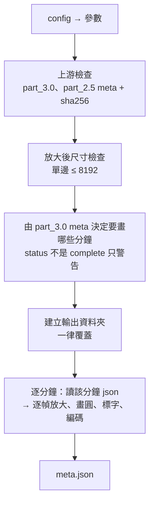

# part_3.5 — 把追蹤結果畫回影片

把 [part_3.0](../part_3.0/README.md) 的追蹤結果畫在拉正後的影片上，讓人用眼睛檢查。**每分鐘一個 mp4**（不會把各分鐘接起來）。

| 項目 | 內容 |
| --- | --- |
| 腳本 | `src/part_3.5/part_3.5_main.py` |
| 上游 | [part_2.5](../part_2.5/README.md)（拉正 mp4）、part_3.0（追蹤結果） |
| 下游 | 無（給人看的）；part_4.0 不依賴它 |
| 特色 | part_3.0 **不必成功**也能畫：失敗 / 中斷 / 還在跑都行，畫到哪算到哪 |

## 用法

```bash
python src/part_3.5/part_3.5_main.py MANIFEST_JSON START_MIN END_MIN
# 例
python src/part_3.5/part_3.5_main.py manifest.json 202605211317 202605211359
```

## 輸入

| 輸入 | 說明 |
| --- | --- |
| `START_MIN` / `END_MIN` | 必須與前面的 part 相同 |
| `part_2.5/mp4s/{分鐘}.mp4` | 拉正後的 mp4 |
| `part_2.5/meta.json` | 取得拉正尺寸與每分鐘幀數 |
| `part_3.0/meta.json` + `{分鐘}.json` | 只檢查 `meta.json`（它也記錄了 part_2.5 的版本，用 sha256 比對）。**`status` 不是 `complete` 只警告**，只畫 `meta.json["minutes"]` 裡有的分鐘 |
| `config.json` 的 `part_3.5` | 見下 |

> [!NOTE]
> 失敗那一分鐘 = 畫「失敗前」的部分結果；若失敗發生在該分鐘**第一個處理的幀**、根本沒有 json，就只畫失敗那一幀。完全沒有東西可畫 → 報錯。

## 輸出

`{output}/{START}_{END}/part_3.5/`

| 檔案 | 內容 |
| --- | --- |
| `mp4s/{YYYYMMDDHHMM}.mp4` | 畫了圓的影片；放大 `scale` 倍；幀數與 part_2.5 相同 |
| `meta.json` | `params`（含顏色與半徑公式）、`part_3_status`、`part_3_failed`、`skipped_minutes`（part_3.0 沒有結果、沒畫的分鐘）、`rectified_size`、`out_size`、`minutes`（每分鐘的幀數 / 有 part_3.0 結果的幀數 / 沿用上一筆的幀數 / 畫了哪個幀範圍 / part_3.0 是否完整）、`inputs`（part_2.5 與 part_3.0 的 meta sha256） |

## 怎麼畫

每個點以圓心畫**空心圓**，半徑 = `追蹤半徑 × rmul + radd`（拉正後像素），再乘上 `scale`。

### 顏色（BGR）

| 對象 | 顏色 | 說明 |
| --- | --- | --- |
| 右眼 | 🔴 紅 | |
| 左眼 | 🔵 藍 | |
| 腹部 `detected` | 🟢 綠 | 偵測到的 |
| 腹部 `predicted` | 🟣 洋紅 | 沒找到、用兩眼 + 相對位置推算（信心低） |
| 腹部允許範圍（橢圓） | 🟠 橘 | 以兩眼為基準的橢圓（平行兩眼連線的半軸短、垂直的半軸長），每一幀都畫；來自 part_3.0 的 `body_zone`（見 [part_3.0](../part_3.0/README.md#允許範圍以雙眼為準的橢圓)） |
| 搜尋範圍 / gate | 🟡 黃 | 只在失敗那一幀出現 |

### 每一幀怎麼決定畫什麼

| 該幀的狀況 | 畫什麼 | 線寬 | 左上角標字 |
| --- | --- | --- | --- |
| 有 part_3.0 結果（`kind = seed / sample / frame`） | 那一筆 | `thickness_tracked` | `時間  tracked:kind` |
| 沒有結果（眼睛沒動、沒有逐幀處理） | **沿用時間上最近的前一筆** | `thickness_hold` | `時間  hold(上一筆的時間)` |
| 超出有結果的範圍（part_3.0 沒做完的部分） | 不畫圓 | — | `no part_3.0 result` |
| 腹部是 `predicted` | 洋紅圓 | — | 另外加 `belly predicted` |
| 有 `body_zone` | 另外畫橘色橢圓 | `thickness_zone` | — |

> [!TIP]
> 沿用上一筆的幀若烏賊其實動了，就會看到圓沒有跟上——這正是用來檢查「有沒有漏看」的方式。

### part_3.0 失敗時的那一幀

標字會加 `FAILED`，並依失敗原因畫不同的輔助圖形：

| 失敗原因 | 畫什麼 | 標字 |
| --- | --- | --- |
| 邊界幀找不到眼睛（有 `gate_px`） | **彩色圓** = 最後一個好的位置；**黃色圓**（半徑 = `boundary_search_px`，以最後好的兩眼為圓心）= 每隻眼允許出現的範圍 | `FAILED: eyes not found (colored circle = last good, yellow circle = allowed move range)` |
| 一般幀找不到眼睛 | 彩色圓 = 最後一個好的位置；**黃色矩形** = 當時的搜尋範圍 | `FAILED: eyes not found (circle = last good, yellow box = search area)` |
| 找到了，但與上一個位置差太多（邊界檢查） | part_3.0 當時找到的位置 | `FAILED: found here but does not match the previous frame (boundary check)` |

用它判斷是該放大搜尋範圍、調低 `eye_k_z`，還是目標真的跳走了。

## config.json 的 `part_3.5`

沒寫的用預設值；寫了不認得的名稱就報錯。

| 參數 | 預設 | 範圍 | 意義 |
| --- | --- | --- | --- |
| `rmul` | `1.2` | `> 0` | 畫的半徑 = 追蹤半徑 × `rmul` + `radd` |
| `radd` | `1.0` | `≥ 0` | 同上（拉正後像素） |
| `scale` | `4` | `1 ~ 32`（整數） | 輸出相對拉正影片放大的倍率。放大才看得清楚小圓；越大越慢、檔案越大；放大後單邊上限 8192 |
| `thickness_tracked` | `2` | `1 ~ 10`（整數） | 有 part_3.0 結果的幀的線寬（放大後像素） |
| `thickness_hold` | `1` | `1 ~ 10`（整數） | 沿用上一筆的幀的線寬 |
| `thickness_zone` | `1` | `1 ~ 10`（整數） | 腹部允許範圍橢圓的線寬 |

## 執行順序



> [!WARNING]
> 任何一分鐘畫失敗（解碼 / 編碼 / json 格式不對）→ 立刻報錯結束。

## 函數表

共用函數（`run_encode_mp4_stage` 等）見 [tool/README.md](../tool/README.md)。

| 函數 | 輸入 → 輸出 | 呼叫時機 |
| --- | --- | --- |
| `check_out_wh_is_valid` | `rectified_wh, up_int` → `None` | 一次；放大後尺寸不得超過 8192（在建立輸出資料夾前檢查） |
| `get_minute_strs_from_meta_dict` | `meta_3_dict, minute_strs` → `list[str]` | 一次；part_3.0 meta 裡有結果的分鐘（含「只有失敗那一幀」的分鐘）；`status` 不是 `complete` 只警告，完全沒有才報錯 |
| `get_entry_dict_list_from_minute_str` | `part_3_dir_path, minute_str, frame_count_int, complete_bool, has_json_bool` → `list[dict]` | 每分鐘一次；讀該分鐘 json 並檢查（幀序遞增不重複、在影片範圍內；完整的分鐘要由 0 開始；沒有 json = 空 list） |
| `get_range_tuple_from_entry_dict_list` | `entry_dict_list, failed_frame_int, frame_count_int, complete_bool` → `(lo, hi)` | 每分鐘一次；有東西可畫的幀範圍 |
| `get_entry_dict_or_none_and_mode_str_from_index` | `index_int, frame_to_entry_dict, frame_ints, entry_dict_list, range_tuple` → `(entry \| None, 模式字串, 是否沿用)` | 每幀；有該幀的結果就用，否則沿用前一筆，超出範圍回 `None` |
| `get_circle_args_tuple_or_none` | `entry_dict, key_str, up_int, param_dict` → `(圓心, 半徑) \| None` | 每幀每個點；`cv2.circle` 用 shift = 4 的定點數 |
| `get_bgr_tuple_from_key_str` | `entry_dict, key_str` → `BGR` | 每幀每個點；腹部 `predicted` 用不同顏色 |
| `draw_entry_on_arr` | `bgr_arr, entry_dict, up_int, thickness_int, param_dict` → `None` | 每幀；畫三個圓 |
| `draw_zone_on_arr` | `bgr_arr, zone_floats, up_int, thickness_int` → `None` | 每幀（entry 有 `body_zone` 時）；橘色橢圓，`zone_floats = [cx, cy, a_par, a_perp, angle_deg]` |
| `draw_search_box_on_arr` | `bgr_arr, box_floats, up_int, thickness_int` → `None` | 失敗那一幀（無 gate）；黃色搜尋框 |
| `draw_gate_on_arr` | `bgr_arr, last_good_dict, up_int, thickness_int` → `None` | 失敗那一幀（有 gate）；以兩眼為圓心的黃色圓，半徑 = `gate_px` |
| `draw_label_on_arr` | `bgr_arr, text_str, up_int` → `None` | 每幀；左上角標字 |
| `get_clock_str_from_minute_str` | `minute_str, sec_float` → `str` | 每幀；`HH:MM:SS.mmm` |
| `get_convert_func_from_entry_dict_list` | `minute_str, entry_dict_list, out_wh, up_int, param_dict, range_tuple, failed_dict` → `func` | 每分鐘一次；回傳區域函數 `get_drawn_arr_from_bgr_arr(幀序號, 秒, bgr_arr)` → 畫好的放大影格（每幀呼叫） |
| `run_minute_stage` | `minute_str, in_mp4_path, out_mp4_path, entry_dict_list, out_wh, up_int, param_dict, range_tuple, failed_dict` → `dict` | 每分鐘一次；編碼一分鐘並回傳統計 |
| `run_all_stages` | `argv_strs` → `None` | `main()` 呼叫；整個流程 |
| `main` | — → `None` | 進入點 |

> [!NOTE]
> 檔案開頭的 `get_tool_dir_str_from_argv_strs` 與 `sys.path.insert` 是固定樣板：先用標準函式庫讀 manifest.json（第一個引數）找到 tool 資料夾，再載入 `tool_main` / `tool_manifest`。
