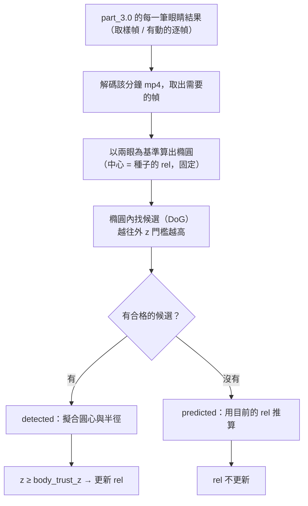
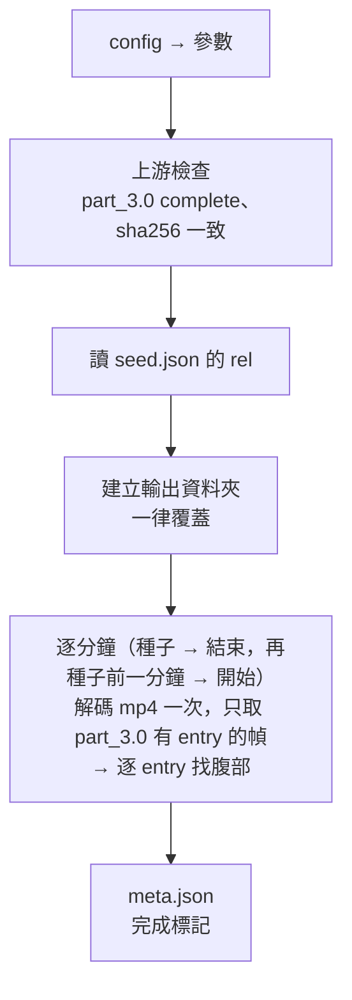

# part_4.0 — 找腹部

依 [part_3.0](../part_3.0/README.md) 追蹤到的兩眼，在**以雙眼為準的橢圓**內找烏賊的腹部，每個有眼睛結果的幀輸出腹部的圓心與半徑。

| 項目 | 內容 |
| --- | --- |
| 腳本 | `src/part_4.0/part_4.0_main.py` |
| 上游 | [part_2.5](../part_2.5/README.md)（拉正 mp4）、[part_3.0](../part_3.0/README.md)（眼睛，需 `status = complete`）、[part_2.0](../part_2.0/README.md)（`seed.json` 的 `rel`） |
| 下游 | [part_4.5](../part_4.5/README.md)（把眼睛與腹部畫回影片）、[part_5.0](../part_5.0/README.md)（腹部顏色） |

> [!IMPORTANT]
> part_4.0 需要**整個範圍**的眼睛結果：part_3.0 的 `meta.json` 必須 `status = "complete"`，且是由目前的 part_2.5 / part_2.0 算出來的（sha256）。
> 眼睛追蹤失敗 / 中斷時，只能先用 [part_3.5](../part_3.5/README.md) 檢查眼睛、調 part_3.0 的參數。

## 用法

```bash
python src/part_4.0/part_4.0_main.py MANIFEST_JSON START_MIN END_MIN
# 例
python src/part_4.0/part_4.0_main.py manifest.json 202605211317 202605211359
```

## 為什麼腹部要獨立成一個 part

| 原因 | 說明 |
| --- | --- |
| 眼睛與腹部的調參互不影響 | 眼睛是小而深的點，腹部是大片淡淡的暗塊，要調的參數完全不同。分開後，改腹部的參數**不必重新追蹤眼睛**（眼睛追蹤是最花時間的一步） |
| 腹部找錯不會帶壞眼睛 | 先前腹部的證據會影響眼睛標籤；現在眼睛只由 part_3.0 決定，腹部只是在它之上加一層 |
| 各自可檢查 | 眼睛看 part_3.5，眼睛 + 腹部看 part_4.5 |

## 流程



處理順序與 part_3.0 相同：**從種子分鐘第 0 幀往後**（種子分鐘 → 結束分鐘），再**往前**（種子前一分鐘 → 開始分鐘）。
`rel` 沿著這個順序一幀一幀傳遞；往前時從「種子分鐘第一筆 entry（通常是第 0 幀）處理完之後的 `rel`」開始。

## 腹部怎麼找

腹部**不是獨立搜尋**，而是用眼睛的位置加上「腹部相對兩眼的位置 `rel`」（`u`、`v`、半徑比，定義見 [part_2.0](../part_2.0/README.md#腹部相對位置-rel)）。

### 允許範圍：以雙眼為準的橢圓

腹部只在一個**橢圓形的允許範圍**內找，橢圓以兩眼為基準：

```text
                      n_hat（垂直於兩眼連線；允許偏移較多）
                           ▲
                    ┌──────┼──────┐
                  ╱        │        ╲
   e_hat ◄───────●─────────◆─────────●───────►   ◆ = 種子的 rel 對應的位置（橢圓中心）
   （平行於兩眼連線；        ╲        │        ╱     ● = 兩眼
     允許偏移較少）          └──────┼──────┘
```

| 量 | 值 |
| --- | --- |
| 中心 | **種子的 `rel`**（part_2.0 你點的腹部相對兩眼的位置）對應的位置；**整個處理過程不變** |
| 平行於兩眼連線的半軸 | `body_zone_par × 眼距` |
| 垂直於兩眼連線的半軸 | `body_zone_perp × 眼距`（通常比較大，但不要太大） |
| 橢圓的方向 | 隨兩眼連線轉動 |

橢圓**相對於兩眼是固定的**：烏賊轉向、移動時橢圓會跟著兩眼轉、跟著動，但它相對於兩眼的位置與大小從頭到尾不變，不會因為偵測到的腹部而移動。
part_4.5 會把每一幀的橢圓用**橘色**畫出來。

### 越往外門檻越高

候選點的 z 要大於一個**隨位置變化的門檻**：橢圓中心最寬鬆，邊緣最嚴格。

```text
ρ   = 候選點在橢圓座標下的歸一化距離（中心 = 0，邊緣 = 1，ρ > 1 直接丟掉）
thr = body_k_z + (body_k_z_edge − body_k_z) × ρ
條件：z > thr
```

通過門檻的候選，用 **`min(z, z_cap) / thr`** 排名，取最高的：

- 靠近中心的弱點（門檻低）可以贏過邊緣的普通點；
- 但邊緣的**很明顯的點**（z 遠高於它的門檻）仍然贏得過中心的雜訊；
- 所以「越靠近中心越優先、越往外要求越高」，而不是單看 z 或單看距離。

其他條件：候選半徑要在 `body_r_ratio × 預測半徑` 內；不能與兩眼重疊。擬合後半徑仍要在範圍內。

> [!NOTE]
> 腹部通常是一大片淡淡的暗塊，不是眼睛那種小而深的點。`body_r_ratio` 太窄會把它擋掉，只留下裡面的小斑點——預設已放寬到 `[0.3, 4.0]`。

找不到任何候選 → `body_status = predicted`（用推算的位置，信心低；`body_score` = NaN）；part_4.5 用洋紅色畫。

### `rel` 的更新：只用於推算

> [!IMPORTANT]
> `seed.json`（你在 part_2.0 視窗二點的種子）提供**起始**的 `rel`，並且決定橢圓的中心（固定）。
> 另外維護一個會更新的 `rel`，**只用來推算**腹部找不到時（`predicted`）的位置與半徑：
>
> - 這一幀腹部偵測到、且 z ≥ `body_trust_z` → 用這一幀的兩眼與腹部重算 `rel`，下一幀就用新的。
> - 這一幀腹部沒偵測到（`predicted`）或信心不夠 → 沿用上一幀的 `rel`，不更新（推算的位置不能拿來更新自己）。
>
> 每個 entry 的 `rel` 欄位記錄了該幀之後使用的值。

> [!TIP]
> `body_trust_z` 要比 `body_k_z`、`body_k_z_edge` 高很多才有意義（`body_k_z` 只是「有東西」的下限，`body_trust_z` 是「可以用它更新 `rel`」）。看 `{分鐘}.json` 裡 `body_score` 的大小：正常偵測的值應該遠大於 `body_trust_z`，雜訊造成的假偵測則接近 `body_k_z`。

### 擬合（圓心與半徑）

與眼睛相同：在平滑後的影像上由圓心向外取 `fit_rays` 條射線，找梯度最大處擬合圓（半徑上限 `fit_rmax_mul × r`，並限制在腹部到最近一隻眼睛距離的 0.85 內）。`fit` 欄位：`edge` / `ray` / `scale`（意義見 [part_3.0](../part_3.0/README.md#4-擬合圓心與半徑)）；`predicted` 時為 `null`。

## 輸入

| 輸入 | 說明 |
| --- | --- |
| `START_MIN` / `END_MIN` | 必須與前面的 part 相同 |
| `part_2.5/mp4s/{分鐘}.mp4` | 拉正後的 mp4（在這裡找腹部）；part_3.0 的 entry 需要的幀都要解得出來 |
| `part_3.0/{分鐘}.json` + `meta.json` | 每一筆 entry 的兩眼位置與半徑。`meta.json`：`status = complete`，且記錄的 part_2.5 / part_2.0 版本要是目前的（sha256） |
| `part_2.0/seed.json` | `rel`（`u`、`v`、`belly_r_rel`）與種子分鐘 |
| `config.json` 的 `part_4.0` | 見下 |

## 輸出

`{output}/{START}_{END}/part_4.0/`

### `{分鐘}.json`

每分鐘一個檔，內容是 entry 的陣列（依 `frame` 排序），**與 part_3.0 同一分鐘的 entry 一對一**（相同的 `frame`、`time`）。座標 = 拉正後影格像素，**像素中心在整數**。

| 欄位 | 說明 |
| --- | --- |
| `time` / `minute` / `frame` / `sec` / `kind` | 與 part_3.0 的同一筆相同 |
| `body` / `body_r` | 腹部圓心 `[x, y]` 與半徑 |
| `body_status` | `detected`（偵測到）或 `predicted`（推算的，信心低） |
| `body_score` | 偵測到時的 z；`predicted` 時為 NaN |
| `rel` | `{u, v, belly_r_rel}`：這一幀之後使用的腹部相對位置（只用於推算） |
| `body_zone` | `[cx, cy, a_par, a_perp, angle_deg]`：這一幀的允許範圍（橢圓中心、兩個半軸（像素）、平行軸的角度）；part_4.5 用它畫橘色橢圓 |
| `fit` | 擬合方法；`predicted` 時為 `null` |

### `meta.json`

`params`、`inputs`（part_2.5、part_3.0、part_2.0 的 meta sha256）、`seed`（種子分鐘與 `rel`）、`minutes`（每分鐘：`entries`、`by_body_status`）、`created_at`。**最後才寫 = 完成標記**。

## config.json 的 `part_4.0`

沒寫的用預設值；寫了不認得的名稱就報錯；型別與範圍不合會指出是哪個參數。

### 找點（與 part_3.0 同一套公式，各自的 config）

| 參數 | 預設 | 範圍 | 意義 |
| --- | --- | --- | --- |
| `polarity` | `"dark"` | `dark` / `bright` | 目標比背景暗（`dark`）或亮（`bright`） |
| `margin` | `0.10` | `[0, 0.4)` | 影格四周忽略的比例（× 短邊） |
| `r_min` | `1.0` | `> 0` | 可偵測的最小圓半徑（拉正後像素） |
| `r_max` | `14.0` | `> r_min` | 可偵測的最大圓半徑（腹部比眼睛大，必要時調大） |
| `sigma_k` | `1.4` | `> 1` | 相鄰兩個卷積尺度 σ 的比值上限 |
| `k_z` | `2.5` | `> 0` | 候選點的 z 下限（腹部另外用 `body_k_z`） |
| `max_cand` | `12` | `3 ~ 200` | 每個搜尋範圍最多保留幾個候選 |
| `z_cap` | `200.0` | `> 0` | z 進入排名前的上限 |
| `fit_rays` | `24` | `8 ~ 360` | 擬合時的射線數 |
| `fit_rmax_mul` | `2.2` | `> 1` | 擬合時射線最遠到 `fit_rmax_mul × r` |
| `fit_smooth` | `0.6` | `> 0` | 擬合前的高斯模糊 σ |

卷積的層數與尺度公式見 [part_3.0](../part_3.0/README.md#卷積的大小界線)；啟動時會印出實際的尺度。

### 腹部

| 參數 | 預設 | 範圍 | 意義 |
| --- | --- | --- | --- |
| `body_r_ratio` | `[0.3, 4.0]` | `[小, 大]`，小 < 大，皆 > 0 | 腹部半徑相對推算半徑的範圍 |
| `body_zone_par` | `0.4` | `> 0` | 允許範圍（橢圓）平行於兩眼連線的半軸，單位 = 眼距 |
| `body_zone_perp` | `0.8` | `> 0` | 允許範圍垂直於兩眼連線的半軸，單位 = 眼距（通常比 `body_zone_par` 大） |
| `body_k_z` | `2.0` | `> 0` | 腹部候選的 z 門檻：橢圓**中心**的值（最寬鬆） |
| `body_k_z_edge` | `8.0` | `≥ body_k_z` | 腹部候選的 z 門檻：橢圓**邊緣**的值（最嚴格）；中間線性內插 |
| `body_trust_z` | `15.0` | `> 0` | 腹部偵測的 z ≥ 此值才用它更新 `rel`（高信心）；調成極大的值 = 一直用種子的 `rel` |

### 調參對照

| 現象 | 先看哪個參數 |
| --- | --- |
| 腹部常是 `predicted` | 腹部真的離種子位置太遠（橢圓固定，調大 `body_zone_par` / `body_zone_perp`）、`body_k_z` / `body_k_z_edge` 太高、`body_r_ratio` 太窄、`r_max` 沒涵蓋腹部大小 |
| 腹部跳來跳去 | 縮小橢圓（`body_zone_*`）、提高 `body_k_z_edge`（邊緣更嚴） |
| 推算的位置（`predicted`）漸漸不準 | 降低 `body_trust_z`（更常更新 `rel`）；或提高它避免被假偵測帶偏 |
| 太慢 | 增大 `sigma_k`（尺度少）、減小 `max_cand` |

## 執行順序



> [!WARNING]
> 任何一分鐘失敗（缺幀、part_3.0 的 json 格式不對）→ 立刻報錯結束。腹部「找不到」不是錯誤，而是 `predicted`。

## 函數表

共用函數（`get_xyrz_list_from_img_arr`、`get_fit_xyr_method_tuple_from_img_arr`、`get_belly_xyr_from_rel_and_eyes`、`get_seed_dict_from_part_dir` 等）見 [tool/README.md](../tool/README.md)。

| 函數 | 輸入 → 輸出 | 呼叫時機 |
| --- | --- | --- |
| `check_body_param_dict` | `param_dict` → `None` | 一次；`body_k_z_edge` 不可小於 `body_k_z` |
| `check_part_3_is_complete` | `meta_3_dict` → `None` | 一次；part_3.0 必須 `complete`，否則說明失敗在哪裡 |
| `get_rel3_dict_from_rel_dict` | `rel_dict` → `dict` | 只留 `u`、`v`、`belly_r_rel` |
| `get_entry_dict_list_from_minute_str` | `part_3_dir_path, minute_str` → `list[dict]` | 每分鐘一次；讀 part_3.0 的 json 並檢查（兩眼座標與半徑有限、`time` 不重複），依 `frame` 排序 |
| `get_eye_xyrs_from_entry_dict` | `entry_dict` → `(右眼 xyr, 左眼 xyr)` | 每個 entry |
| `get_zone_tuple_from_eyes_and_center` | `right_xyr, left_xyr, center_xyr, param_dict` → `(cx, cy, a_par, a_perp, angle_deg)` | 每個 entry；腹部允許範圍（橢圓） |
| `get_rho_float_from_xy_and_zone` | `xy, zone_tuple` → `float` | 每個候選；橢圓座標下的歸一化距離（中心 0、邊緣 1） |
| `get_thr_float_from_rho` | `rho_float, param_dict` → `float` | 每個候選；`body_k_z` 到 `body_k_z_edge` 的線性門檻 |
| `get_belly_dict_from_img_arr` | `img_arr, right_xyr, left_xyr, rel_dict, ref_rel_dict, param_dict` → `dict` | 每個 entry；橢圓中心由種子的 `ref_rel_dict` 決定（固定），在橢圓內依 `min(z, z_cap)/thr` 排名搜尋，找不到就用目前的 `rel_dict` 推算（`status = predicted`） |
| `is_belly_trusted` | `belly_dict, param_dict` → `bool` | 每個 entry；偵測到且 z ≥ `body_trust_z` |
| `get_rel_dict_from_belly_dict` | `right_xyr, left_xyr, belly_dict, rel_dict, param_dict` → `dict` | 每個 entry；高信心偵測 → 重算 `rel`，否則沿用 |
| `get_out_entry_dict_from_belly_dict` | `entry_dict, belly_dict, rel_dict` → `dict` | 每個 entry；寫進 `{分鐘}.json` 的一筆 |
| `get_index_to_gray_dict_from_mp4_path` | `mp4_path, wanted_ints` → `dict[int, 灰階陣列]` | 每分鐘一次；解碼一次，只留需要的幀；缺幀就報錯 |
| `run_minute_stage` | `minute_str, mp4_path, entry_dict_list, order_str, rel_dict, ref_rel_dict, param_dict` → `(list[dict], rel_dict)` | 每分鐘一次；依方向逐 entry 找腹部並傳遞 `rel` |
| `get_stat_dict_from_out_dict_list` | `out_dict_list` → `dict` | 每分鐘；`meta.json` 的 `minutes` |
| `get_meta_dict_from_stage_results` | `args_ns, manifest_dict, param_dict, seed_dict, ts_to_stat_dict` → `dict` | 一次；`meta.json` 內容 |
| `run_all_stages` | `argv_strs` → `None` | `main()` 呼叫；整個流程 |
| `main` | — → `None` | 進入點 |

> [!NOTE]
> 檔案開頭的 `get_tool_dir_str_from_argv_strs` 與 `sys.path.insert` 是固定樣板：先用標準函式庫讀 manifest.json（第一個引數）找到 tool 資料夾，再載入 `tool_main` / `tool_manifest`。
