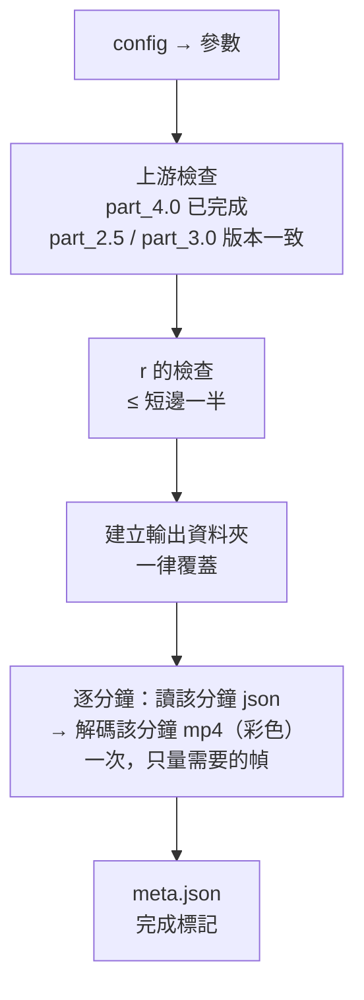

# part_5.0 — 腹部中心、固定半徑內的平均顏色

以 [part_4.0](../part_4.0/README.md) 找到的腹部圓心為中心、**固定半徑 `r`**，量圓內的平均顏色（灰階亮度與 B / G / R 各通道），並量背景環做對照。每分鐘輸出一個 json（dict，key = 時間）。

> [!NOTE]
> 半徑是 config 的固定值，**不用**腹部偵測到的半徑：腹部的半徑每幀會有擬合誤差，固定半徑才能讓不同時間的平均值可以直接比較。

| 項目 | 內容 |
| --- | --- |
| 腳本 | `src/part_5.0/part_5.0_main.py` |
| 上游 | [part_2.5](../part_2.5/README.md)（拉正 mp4，顏色在這裡量）、[part_4.0](../part_4.0/README.md)（腹部圓心） |
| 下游 | [part_5.5](../part_5.5/README.md)（畫成折線圖） |

> [!IMPORTANT]
> part_5.0 需要**整個範圍**的腹部結果：part_4.0 必須完整跑完（它只有完成才會寫 `meta.json`），且是由目前的 part_3.0 算出來的。part_3.0 失敗 / 中斷的部分結果只給 [part_3.5](../part_3.5/README.md) 看。

## 用法

```bash
python src/part_5.0/part_5.0_main.py MANIFEST_JSON START_MIN END_MIN
# 例
python src/part_5.0/part_5.0_main.py manifest.json 202605211317 202605211359
```

## 輸入

| 輸入 | 說明 |
| --- | --- |
| `START_MIN` / `END_MIN` | 必須與前面的 part 相同 |
| `part_2.5/mp4s/{分鐘}.mp4` | 拉正後的 mp4（顏色在這裡量） |
| `part_4.0/{分鐘}.json` + `meta.json` | 每個被追蹤的影格的腹部圓心。`meta.json` 要存在（= part_4.0 完成），且記錄的 part_2.5 與 part_3.0 版本要是目前的（sha256） |
| `config.json` 的 `part_5.0` | 見下 |

## 輸出

`{output}/{START}_{END}/part_5.0/`

### `{YYYYMMDDHHMM}.json`

dict：key = part_4.0 同一筆的 `time`（不重複，與 part_3.0 的 `time` 相同），value：

| 欄位 | 說明 |
| --- | --- |
| `mean` | 以腹部圓心為中心、半徑 `r` 內所有像素的灰階亮度平均（0~255；由 BGR 轉灰階） |
| `mean_b` / `mean_g` / `mean_r` | 同一個圓內，B、G、R 各通道的平均（0~255） |
| `std` | 圓內像素亮度的標準差 |
| `n_pixels` | 圓內的像素數 |
| `bg_mean` | 背景環（半徑 `r + ring[0]` ~ `r + ring[1]`）的亮度平均 |
| `contrast` | `bg_mean − mean`（腹部比背景暗多少；亮的話為負） |
| `r` | 實際使用的半徑（config 的 `r`，拉正後像素） |
| `status` | `ok`，或 `no_pixels`（圓完全在影格外，數值為 NaN） |
| `body_status` | part_4.0 對該筆腹部的標示：`detected` / `predicted`。**`predicted` 的圓心是推算的，信心低** |
| `frame`、`body` | 該筆的幀序號與圓心 `[x, y]`（方便回查） |

```text
        ┌─────── 背景環：r + ring[0] ~ r + ring[1] ───────┐
        │    ┌──── 圓內：距圓心 ≤ r ────┐                  │
        │    │        ● 腹部圓心         │                  │
        │    └──────────────────────────┘                  │
        └──────────────────────────────────────────────────┘
```

### `meta.json`

`params`（含單位說明）、`inputs`（part_2.5 與 part_4.0 的 meta sha256）、`minutes`（每分鐘：`entries`、`by_status`、`by_body_status`）、`created_at`。**最後才寫 = 完成標記**。

## config.json 的 `part_5.0`

沒寫的用預設值；寫了不認得的名稱就報錯。

| 參數 | 預設 | 範圍 | 意義 |
| --- | --- | --- | --- |
| `r` | `3.0` | `> 0`，且 ≤ 拉正尺寸短邊的一半 | 量測圓的半徑（拉正後像素） |
| `ring` | `[1.0, 3.0]` | `[內, 外]`，內 < 外，皆 ≥ 0 | 背景環：距離圓邊緣多少像素（拉正後像素） |

## 座標

與 part_3.0、part_4.0 相同：拉正後影格像素，**像素中心在整數**；像素 `(i, j)` 的中心與圓心的距離 `≤ r` 就算在圓內。

## 執行順序



> [!WARNING]
> 任何一分鐘失敗（缺幀、json 異常、腹部座標不是有限數字）→ 立刻報錯結束。

## 函數表

共用函數見 [tool/README.md](../tool/README.md)。

| 函數 | 輸入 → 輸出 | 呼叫時機 |
| --- | --- | --- |
| `check_r_float` | `r_float, rectified_wh` → `None` | 一次；`r` 不可超過短邊一半 |
| `get_entry_dict_list_from_minute_str` | `part_4_dir_path, minute_str` → `list[dict]` | 每分鐘一次；讀 part_4.0 該分鐘的 json 並檢查（每筆有字串 `time`、整數 `frame`；`time` 不重複） |
| `get_nan_value_dict` | `r_float, status_str` → `dict` | 量不到時（每個無效幀）；數值 NaN |
| `get_window_tuple_from_xy` | `center_xy, radius_float, frame_wh` → `(x0, y0, x1, y1)` | 每個被量的幀；涵蓋半徑的最小視窗 |
| `get_inner_ring_mask_arr_tuple` | `window_tuple, center_xy, r_float, ring_floats` → `(圓內遮罩, 背景環遮罩)` | 每個被量的幀 |
| `get_value_dict_from_bgr_arr` | `bgr_arr, body_xy, param_dict` → `dict` | 每個被量的幀；`mean / std / bg_mean / contrast / mean_b / mean_g / mean_r / n_pixels`（灰階由 BGR 轉出） |
| `run_minute_stage` | `minute_str, mp4_path, entry_dict_list, param_dict` → `dict` | 每分鐘一次；解碼一次、只量需要的幀，回傳 `{time: value_dict}` |
| `get_meta_dict_from_stage_results` | `args_ns, manifest_dict, param_dict, ts_to_stat_dict` → `dict` | 一次；`meta.json` 內容 |
| `run_all_stages` | `argv_strs` → `None` | `main()` 呼叫；整個流程 |
| `main` | — → `None` | 進入點 |

> [!NOTE]
> 檔案開頭的 `get_tool_dir_str_from_argv_strs` 與 `sys.path.insert` 是固定樣板：先用標準函式庫讀 manifest.json（第一個引數）找到 tool 資料夾，再載入 `tool_main` / `tool_manifest`。
