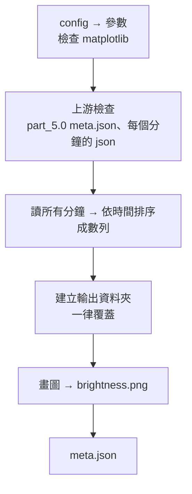

# part_5.5 — 時間與亮暗度的折線圖

把 [part_5.0](../part_5.0/README.md) 的腹部亮度畫成**「時間 — 亮暗度」折線圖**（一張 PNG，整個範圍的所有點畫在同一條時間軸上）。

| 項目 | 內容 |
| --- | --- |
| 腳本 | `src/part_5.5/part_5.5_main.py` |
| 上游 | [part_5.0](../part_5.0/README.md)（每分鐘一個 json） |
| 下游 | 無（給人看的） |
| 需要的套件 | `matplotlib`（在 `requirements.txt`；用無視窗的 `Agg` 後端，沒有螢幕也能畫） |

## 用法

```bash
python src/part_5.5/part_5.5_main.py MANIFEST_JSON START_MIN END_MIN
# 例
python src/part_5.5/part_5.5_main.py manifest.json 202605211317 202605211359
```

## 輸入

| 輸入 | 說明 |
| --- | --- |
| `START_MIN` / `END_MIN` | 必須與前面的 part 相同 |
| `part_5.0/meta.json` | 必須存在（它只有完整跑完才會寫）；取得 `params.r` 放在標題 |
| `part_5.0/{分鐘}.json` | 範圍內每個分鐘都要有；缺任何一個分鐘就報錯，不會畫出有洞的圖。每筆要有數字的 `mean`、`mean_b`、`mean_g`、`mean_r`、`bg_mean` 與 `status`、`body_status`，key 是 `YYYY-MM-DDTHH:MM:SS.mmm` |
| `config.json` 的 `part_5.5` | 見下 |

## 輸出

`{output}/{START}_{END}/part_5.5/`

| 檔案 | 內容 |
| --- | --- |
| `brightness.png` | 折線圖（見下） |
| `meta.json` | `params`、`inputs`（part_5.0 的 meta sha256）、`png`、`stat`（點數、可量測的點數、`predicted` 的點數、第一與最後一點的時間、`mean` 的最小 / 最大 / 平均）、`created_at` |

## 圖裡有什麼

x 軸 = 時間（整個範圍），上下兩個子圖共用 x 軸：

| 子圖 | y 軸 | 內容 |
| --- | --- | --- |
| 上：**灰階亮度** | 腹部圓內灰階平均（0–255） | 一條折線 = `mean`。`show_bg = true` 時多一條虛線 = 背景環的灰階平均（`bg_mean`），用來看亮度變化是腹部自己的還是整個畫面的 |
| 下：**各通道**（`show_channels = true`） | 圓內 R / G / B 平均（0–255） | 三條折線，顏色對應通道（紅 / 綠 / 藍），圖例標出 |

- 每個點 = part_5.0 的一筆（取樣幀與細分的逐幀都有），所以烏賊有動的時段點會比較密。
- **腹部 `predicted` 的點**（位置是推算的、信心低）用**紅色 ×** 標在上面的子圖（`mark_predicted = true`）。解讀亮度時請留意這些點。
- `status` 不是 `ok` 的點（圓完全在影格外）是 NaN，圖上會斷線；全部都不是 `ok` 則報錯。
- 圖上的文字一律用英文，避免不同電腦缺中文字型時變成方塊。

> [!NOTE]
> 資料量是「整個範圍所有點」，兩天約數萬點，折線不做平滑或抽樣；要看趨勢可以拿 part_5.0 的 json 自己做移動平均（取樣不是等間隔，直接對點數平均會偏向有動的時段）。

## config.json 的 `part_5.5`

沒寫的用預設值；寫了不認得的名稱就報錯。

| 參數 | 預設 | 範圍 | 意義 |
| --- | --- | --- | --- |
| `width_in` | `16.0` | `2 ~ 60` | 圖寬（英吋） |
| `height_in` | `8.0` | `2 ~ 40` | 圖高（英吋；兩個子圖共用） |
| `dpi` | `150` | `50 ~ 400`（整數） | 解析度；輸出像素 = 英吋 × dpi（預設 2400 × 1200） |
| `line_width` | `0.8` | `0.1 ~ 5` | 折線線寬 |
| `show_channels` | `true` | `true` / `false` | 是否畫下面的 R / G / B 子圖 |
| `show_bg` | `false` | `true` / `false` | 上圖是否加背景環的虛線 |
| `mark_predicted` | `true` | `true` / `false` | 是否把腹部 `predicted` 的點標成紅色 × |

## 執行順序



> [!WARNING]
> 缺 matplotlib、缺分鐘、json 格式不對、時間重複、沒有任何可量測的點 → 立刻報錯結束。

## 函數表

| 函數 | 輸入 → 輸出 | 呼叫時機 |
| --- | --- | --- |
| `get_plt_module` | — → `pyplot` | 一次（先檢查、再畫圖）；用 `Agg` 後端，缺套件時報錯並提示 `pip install -r requirements.txt` |
| `get_value_dict_from_json_obj` | `json_obj, minute_str` → `dict` | 每分鐘一次；檢查 part_5.0 json 的格式 |
| `get_all_time_to_value_dict` | `part_5_dir_path, minute_strs` → `dict[時間, value]` | 一次；讀所有分鐘並合併，時間不可重複 |
| `get_series_dict_from_value_dicts` | `time_to_value_dict` → `dict` | 一次；依時間排序成 `time`、`mean`、`mean_b/g/r`、`bg_mean`、`predicted`、`ok` 數列 |
| `get_stat_dict_from_series_dict` | `series_dict` → `dict` | 一次；點數與 `mean` 的統計，寫進 `meta.json` |
| `get_title_str` | `args_ns, meta_5_dict, series_dict` → `str` | 一次；圖的標題（時間範圍、半徑、點數） |
| `init_axis` | `ax_obj, ylabel_str` → `None` | 每個子圖；淡色格線、只留左與下的軸線 |
| `draw_gray_panel` | `ax_obj, series_dict, param_dict` → `None` | 一次；上圖（灰階、背景環、predicted 標記） |
| `draw_channel_panel` | `ax_obj, series_dict, param_dict` → `None` | 一次；下圖（R / G / B） |
| `save_figure_to_path` | `series_dict, title_str, param_dict, png_path` → `None` | 一次；組合兩個子圖並存成 PNG |
| `run_all_stages` | `argv_strs` → `None` | `main()` 呼叫；整個流程 |
| `main` | — → `None` | 進入點 |

> [!NOTE]
> 檔案開頭的 `get_tool_dir_str_from_argv_strs` 與 `sys.path.insert` 是固定樣板：先用標準函式庫讀 manifest.json（第一個引數）找到 tool 資料夾，再載入 `tool_main` / `tool_manifest`。
