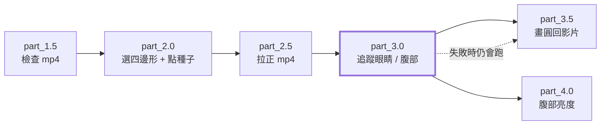

# run_all

依序執行整條流程 `part_1.5 → part_2.0 → part_2.5 → part_3.0 → part_3.5 → part_4.0`，同一個時間範圍、同一個 manifest。

| 項目 | 內容 |
| --- | --- |
| 腳本 | `src/run_all/run_all_main.py` |
| 依賴 | 只用標準函式庫 + `tool_manifest.py`（所以用任何 `python3` 啟動都可以） |
| 子行程 | 每個 part 都用 **manifest 的 `python`**（例如 `venv/bin/python`）啟動 |
| 寫檔 | 不寫任何檔案；輸出都在各 part 自己的資料夾 |

## 用法

```bash
python src/run_all/run_all_main.py MANIFEST_JSON START_MIN END_MIN [--start PART] [--end PART]
# 例：全部跑
python src/run_all/run_all_main.py manifest.json 202605211317 202605211359
# 例：只跑 part_2.5 到 part_3.5（含頭尾）
python src/run_all/run_all_main.py manifest.json 202605211317 202605211359 --start 2.5 --end 3.5
```

| 引數 | 說明 |
| --- | --- |
| `MANIFEST_JSON` | manifest.json 的路徑（相對於目前工作目錄，或絕對路徑）。格式見 [tool/README.md](../tool/README.md#manifestjson) |
| `START_MIN` / `END_MIN` | 完整 12 位 `YYYYMMDDHHMM`，含頭尾，`START_MIN ≤ END_MIN` |
| `--start PART`（選填） | 從這個 part 開始跑（含）。`2.5` 或 `part_2.5` 都可以；預設 `part_1.5` |
| `--end PART`（選填） | 跑到這個 part 為止（含）。預設 `part_4.0` |

可用的 PART：`1.5`、`2.0`、`2.5`、`3.0`、`3.5`、`4.0`。

| `--start` / `--end` | 跑哪些 part |
| --- | --- |
| 都不給 | 全部（`1.5 → … → 4.0`） |
| `--start 2.5` | `2.5 → 3.0 → 3.5 → 4.0` |
| `--end 3.5` | `1.5 → 2.0 → 2.5 → 3.0 → 3.5` |
| `--start 2.5 --end 3.5` | `2.5 → 3.0 → 3.5` |
| `--start 3.0 --end 3.0` | 只有 `3.0`（調 part_3.0 參數時重跑用） |

> [!NOTE]
> 沒被選到的 part 視為「已完成」，run_all 不檢查它們；各 part 自己會檢查上游的 `meta.json`（含 sha256），上游沒跑過或版本不一致就報錯。
> `--start` 在 `--end` 之後、或名稱不認得 → 不開始，直接報錯。進度 `(k/N)` 的 N 是**實際要跑的 part 數**。

## 流程



> [!NOTE]
> 實際順序是 `…→ part_3.0 → part_3.5 → part_4.0`（序列執行）；圖中 part_3.5 與 part_4.0 並列只是表示兩者都只依賴 part_3.0 的結果。

各 part 的說明：

1. [part_1.5](../part_1.5/README.md) — 檢查範圍與 mp4，寫 `files.json`；唯一會問「要覆蓋嗎」的地方
2. [part_2.0](../part_2.0/README.md) — 互動 UI：選四邊形、點右眼 / 左眼 / 腹部
3. [part_2.5](../part_2.5/README.md) — 依四邊形把每分鐘 mp4 拉正
4. [part_3.0](../part_3.0/README.md) — 追蹤右眼、左眼、腹部
5. [part_3.5](../part_3.5/README.md) — 把追蹤結果畫回影片，給人檢查
6. [part_4.0](../part_4.0/README.md) — 腹部附近的亮度統計

## 行為

### 啟動前檢查

在開始任何 part 之前先確認：

- manifest 的 `python` 存在且可執行
- 每個 part 資料夾內都有 `{part}_main.py`

缺任何一個就**不開始**，並列出缺的是哪些。

### 失敗與中斷

| 情況 | 行為 | 結束碼 |
| --- | --- | --- |
| 某個 part 以非 0 結束 | 立刻停止，後面的 part 不跑 | 與該 part 相同 |
| **part_3.0 失敗**（Ctrl-C 除外） | 若 part_3.5 在要跑的範圍內（`--end` 沒有停在 3.0），先跑一次 part_3.5，把 part_3.0 已追蹤的部分畫出來，再結束；**不會**跑 part_4.0 | part_3.0 的結束碼 |
| part_3.5（上述補跑）也失敗 | 只印 `[Warn]`，不影響結束碼 | 仍是 part_3.0 的結束碼 |
| Ctrl-C | 訊號同時送到子行程；本腳本等子行程收尾（例如 part_3.0 要把已有結果存下來）後結束；再按一次 Ctrl-C 則強制 kill | 130 |

> [!TIP]
> part_3.0 的參數要靠看結果調，所以它是**邊跑邊寫** `meta.json` 的：失敗時會留下已追蹤的部分，part_3.5 能畫到失敗那一幀，
> 並用黃色圈（允許移動範圍）或黃框（搜尋範圍）標出它在哪裡找不到。細節見 [part_3.0 的「失敗時」](../part_3.0/README.md#失敗時)。

## 輸出的版面

```text
manifest.json
src/…
output/
└── {START}_{END}/
    ├── part_1.5/   files.json, meta.json
    ├── part_2.0/   roi.json, seed.json, meta.json
    ├── part_2.5/   mp4s/{分鐘}.mp4, meta.json
    ├── part_3.0/   {分鐘}.json, meta.json
    ├── part_3.5/   mp4s/{分鐘}.mp4, meta.json
    └── part_4.0/   {分鐘}.json, meta.json
```

## 畫面輸出

每個腳本啟動時都會先印一條分隔線 `---------------- {script_name} ----------------`，各 part 的訊息之間不會擠在一起；
run_all 在開始時印出實際要跑的 part，每個 part 開始前印 `(k/N) 開始 part_X：…`（N = 要跑的 part 數），結束時才印 `[Success]`。

## 函數表

| 函數 | 輸入 → 輸出 | 呼叫時機 |
| --- | --- | --- |
| `get_tool_dir_str_from_argv_strs` | `argv_strs` → `str` | 載入 tool 之前；由 manifest 找到 tool 資料夾（各 part 都有的固定啟動樣板） |
| `get_script_path_dict_from_manifest_dict` | `manifest_dict` → `dict[part, Path]` | 一次；每個 part 的 `{part}_main.py` 路徑 |
| `check_run_ready` | `manifest_dict, script_path_dict` → `None` | 一次；python 與所有腳本都存在 |
| `get_part_str_from_input_str` | `input_str` → `str` | 每個 `--start` / `--end` 一次；`2.5` 或 `part_2.5` → `part_2.5`，不認得就報錯 |
| `get_selected_part_strs_from_args_ns` | `args_ns` → `tuple[str, ...]` | 一次；由 `--start` / `--end` 得到要跑的 part（依序、含頭尾；start 在 end 之後報錯） |
| `get_cmd_strs_from_part_str` | `part_str, manifest_dict, script_path_dict, args_ns` → `list[str]` | 每個 part 一次；`[python, 腳本, manifest, START, END]` |
| `get_exit_code_int_from_cmd_strs` | `cmd_strs` → `int` | 每個 part 一次；啟動子行程並等它結束（Ctrl-C 時等它收尾，回傳 130） |
| `run_part_stage` | `part_str, cmd_strs, selected_part_strs` → `int` | 每個 part 一次；印 `(k/N) 開始 …` 並回傳 exit code |
| `run_all_stages` | `argv_strs` → `None` | `main()` 呼叫；整個流程 |
| `main` | — → `None` | 進入點 |

> [!NOTE]
> 檔案開頭的 `get_tool_dir_str_from_argv_strs` 與 `sys.path.insert` 是固定樣板：先用標準函式庫讀 manifest.json（第一個引數）找到 tool 資料夾，再載入 `tool_manifest`。
