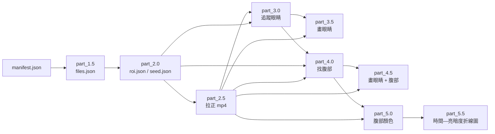

# tool — 共用函數

各 part 共用的函數與啟動外殼。**兩個檔案都不能單獨執行**，由各 part 匯入。

| 檔案 | 依賴 | 內容 |
| --- | --- | --- |
| `tool_manifest.py` | 只用標準函式庫 | 訊息（`[Info]` / `[Warn]` / `[Success]`）、分隔線、manifest 讀取、引數、`main` 外殼 |
| `tool_main.py` | numpy / opencv / av | 其餘所有共用函數（路徑、json、mp4、拉正、找點、擬合…） |

各 part 的 `main` 先讀 manifest.json（第一個引數）找到 tool 資料夾，`sys.path.insert` 之後才 `from tool_manifest import …` / `from tool_main import …`。
所有腳本檔名全專案唯一（`run_all_main.py`、`part_{n}_main.py`、`tool_main.py`、`tool_manifest.py`），所以匯入不會重名。

> [!NOTE]
> 匯入 `tool_main` 時會先印出「載入 numpy / opencv / av …（第一次需要編譯，可能要數十秒）」，載入完再印耗時，所以不會看起來像當掉。

## 目錄

- [專案結構與資料流](#專案結構與資料流)
- [manifest.json](#manifestjson)
- [config.json](#configjson)
- [錯誤處理](#錯誤處理)
- [畫面輸出](#畫面輸出)
- [命名規則](#命名規則)
- [函數表：tool_manifest.py](#函數表tool_manifestpy)
- [函數表：tool_main.py](#函數表tool_mainpy)

## 專案結構與資料流

```text
project/
├── manifest.json
├── config.json
├── assets/{任意}/{YYYYMMDDHH}/NN{...}.mp4     NN = 分鐘 00~59；jpeg 一律忽略（連檢查都不做）
├── src/
│   ├── run_all/   run_all_main.py   README.md
│   ├── part_1.5/  part_1.5_main.py  README.md
│   ├── part_2.0/  …
│   ├── part_2.5/  …
│   ├── part_3.0/  …
│   ├── part_3.5/  …
│   ├── part_4.0/  …
│   ├── part_4.5/  …
│   ├── part_5.0/  …
│   ├── part_5.5/  …
│   └── tool/      tool_main.py  tool_manifest.py  README.md
└── output/
    └── {START}_{END}/                          每個時間範圍 = 一次完整執行
        ├── part_1.5/ … part_5.5/               名稱固定，與 manifest 裡各 part 的路徑無關
```



- 每個時間範圍有自己的 ROI 與種子點；不同範圍的資料夾互不重疊、互不沿用。
- 每個 part 只吃 `python src/part_X/part_X_main.py MANIFEST_JSON START_MIN END_MIN`；上一個 part 的結果由 `START` / `END` 自動找到。
- part_1.5 是唯一會問「要覆蓋嗎」的地方；其餘 part 一律直接覆蓋自己的資料夾。
- `meta.json` 是**完成標記**（[part_3.0](../part_3.0/README.md) 例外：邊跑邊寫）；其中 `inputs` 記錄「這次用了上游哪個 `meta.json`（sha256）」，上游被重做過就會偵測到並報錯。

## manifest.json

記錄各個路徑，所以整個專案（或單一 part 資料夾）可以搬到任何地方。每個腳本的第一個引數就是它的路徑。

```json
{
  "project": ".",
  "assets": "assets",
  "config": "config.json",
  "python": "venv/bin/python",
  "output": "output",
  "tool": "src/tool",
  "parts": {
    "part_1.5": "src/part_1.5",
    "part_2.0": "src/part_2.0",
    "part_2.5": "src/part_2.5",
    "part_3.0": "src/part_3.0",
    "part_3.5": "src/part_3.5",
    "part_4.0": "src/part_4.0",
    "part_4.5": "src/part_4.5",
    "part_5.0": "src/part_5.0",
    "part_5.5": "src/part_5.5"
  }
}
```

| 欄位 | 說明 |
| --- | --- |
| `project` | 專案資料夾。**相對於 manifest.json 所在的資料夾**，或絕對路徑 |
| `assets` | mp4 的根資料夾 |
| `config` | `config.json` |
| `python` | 啟動各 part 子行程用的 python（例如 venv 內的）。以 `os.path.abspath` 解析、**不解析 symlink**，所以 venv 的 python 仍能找到它的 site-packages |
| `output` | 輸出根資料夾；實際輸出一律是 `{output}/{START}_{END}/part_X/` |
| `tool` | tool 資料夾（`tool_main.py` 與 `tool_manifest.py`） |
| `parts` | `{part: 該 part 的資料夾}`；每個 part 的腳本固定是資料夾內的 `{part}_main.py` |

- 除 `project` 以外，**其他路徑都相對於 `project`**；絕對路徑也可以。
- 欄位必須剛好是上面這些（缺少或多出都報錯），`parts` 的名稱必須剛好是九個 part。
- `project` 資料夾必須存在。

## config.json

最外層只允許九個區塊：`part_1.5`、`part_2.0`、`part_2.5`、`part_3.0`、`part_3.5`、`part_4.0`、`part_4.5`、`part_5.0`、`part_5.5`（沒寫的區塊用預設值）。
每個區塊內**沒寫的參數用預設值、寫了不認得的名稱就報錯**，型別與範圍不合會指出是哪個參數。

| 區塊 | 參數與預設 | 完整說明 |
| --- | --- | --- |
| `part_1.5` | `duration_s`、`tolerance_s` | [part_1.5](../part_1.5/README.md#configjson-的-part_15) |
| `part_2.0` | `seed_search_px`（另外用到 `part_3.0` 的「找點」參數） | [part_2.0](../part_2.0/README.md#configjson-的-part_20) |
| `part_2.5` | 無參數 | [part_2.5](../part_2.5/README.md) |
| `part_3.0` | 找點（`polarity`、`margin`、`r_min`、`r_max`、`sigma_k`、`k_z`、`max_cand`、`z_cap`、`fit_*`）+ 眼睛追蹤（`sample_step_s`、`move_tol_px`、`*_search_mul`、`spacing_tol`、`retry_frames`、`move_weight`、`eye_r_ratio`、`size_ratio_max`、`eye_gap`、`eye_k_z`、`eye_z_ratio_min`） | [part_3.0](../part_3.0/README.md#configjson-的-part_30) |
| `part_3.5` | `rmul`、`radd`、`scale`、`thickness_tracked`、`thickness_hold` | [part_3.5](../part_3.5/README.md#configjson-的-part_35) |
| `part_4.0` | 找點（同 part_3.0 的那幾項，各自一份）+ 腹部（`body_r_ratio`、`body_zone_*`、`body_k_z`、`body_k_z_edge`、`body_trust_z`） | [part_4.0](../part_4.0/README.md#configjson-的-part_40) |
| `part_4.5` | `rmul`、`radd`、`scale`、`thickness_tracked`、`thickness_hold`、`thickness_zone` | [part_4.5](../part_4.5/README.md#configjson-的-part_45) |
| `part_5.0` | `r`、`ring` | [part_5.0](../part_5.0/README.md#configjson-的-part_50) |
| `part_5.5` | `width_in`、`height_in`、`dpi`、`line_width`、`show_channels`、`show_bg`、`mark_predicted` | [part_5.5](../part_5.5/README.md#configjson-的-part_55) |

> [!NOTE]
> 「找點」的參數（`BLOB_DEFAULT_DICT` / `BLOB_RULE_DICT_DICT`）定義在 `tool_main.py`，part_2.0 與 part_3.0 共用同一份（part_2.0 讀 `part_3.0` 區塊），part_4.0 讀自己的 `part_4.0` 區塊；眼睛專用的 `size_ratio_max`、`eye_gap` 定義在 part_3.0 自己的 `*_main.py`；
> 各 part 自己的參數（`DEFAULT_PARAM_DICT` / `RULE_DICT_DICT`）定義在各自的 `*_main.py`。規則表支援的型態：`bool`、`int`、`float`、`str`（`choices`）、`float_pair`（`[小, 大]`，小 < 大）；每個數字可以有 `min` / `max` 與是否開區間。

## 錯誤處理

最壞情況假設：

- 任何一步出錯 → 印 `[Error]` → 立刻結束（Python `exit 1`；Ctrl-C `exit 130`）。**沒有「記錄後繼續」**。
- 預期中的錯誤（`FileNotFoundError` / `FileExistsError` / `ValueError` / `ImportError`）只印訊息；其他例外還會印 traceback 並標示「非預期的錯誤」。
- 「找不到」若規格有寫成 NaN 才會是 NaN（例如腹部 `predicted` 的 `body_score`）；其他情況一律報錯結束。
- [run_all](../run_all/README.md) 看每個 part 的 exit code，非 0 就停止整個流程（part_3.0 失敗時會先跑 part_3.5 看已有的結果）。
- 輸入與輸出在檔案之間必須一致；參數一律驗證；每個輸出的 `meta.json` 記錄用了哪個上游（sha256 鏈）。

## 畫面輸出

| 訊息 | 去向 | 說明 |
| --- | --- | --- |
| `---------------- {script_name} ----------------` | stdout | 每個腳本啟動時先印，前後各空一行，各 part 的訊息不會擠在一起（`print_banner`） |
| `[Info]` | stdout | 一般訊息 |
| `[Warn]` | stderr | 警告 |
| `[Ask]` | stdout | 互動詢問（只有 part_1.5 的覆蓋詢問） |
| `[Success]` | stdout | 結束前最後一行，**前面空一行** |
| `[Error]` | stderr | 錯誤，**前面空一行** |

## 命名規則

全專案共用。每個小步驟是一個函數，再一層層組合起來。

### 變數：`<名詞>_<型態>`

| 後綴 | 型態 | 後綴 | 型態 |
| --- | --- | --- | --- |
| `_str` | 字串 | `_arr` | numpy 陣列 |
| `_int` | 整數 | `_obj` | 其他物件 |
| `_float` | 浮點數 | `_ns` | `argparse.Namespace` |
| `_bool` | 布林 | `_tuple` | tuple |
| `_path` | `Path` | `_set` | set |
| `_dict` | dict | `_dt` | `datetime` |
| `_list` | list | `_re` / `_func` | 正規表示式 / 函數 |

- 巢狀：`xxx_dict_list` = list of dict；`a_to_b_dict` = key 為 a、value 為 b 的 dict。
- 基本元素用複數：`nums` / `numss` / `numsss` / `strs` / `strss`（每多一個 `s` 就多一級迭代）。
- 座標：`xy = (x, y)`、`xyr = (x, y, r)`、`xyrz = (x, y, r, z)`、`wh = (寬, 高)`；`xys` = `xy` 的 list。

### 函數：動詞開頭

| 動詞 | 意義 |
| --- | --- |
| `is_X` | 判定，回傳 `bool`，無副作用 |
| `get_X_from_Y` | 輸出 `X`（`Y` 為主要輸入；含讀檔） |
| `gen_X_from_Y` | generator |
| `check_X` | 合法性檢查，不合法就丟例外 |
| `update_X_by_Y` | 原地修改 `X` |
| `draw_X_on_Y` | 把 `X` 畫在 `Y` 上（原地） |
| `save_X_to_Y` | 寫入磁碟 |
| `run_X_stage` | 一個流程階段（由小函數組成） |
| `init_` / `on_` | 只用在 UI：一次性初始化 / 事件處理 |
| `to_X`、`warn`、`info`、`success` | 極簡函數 |

> [!NOTE]
> 程式碼內不放註解與 docstring；所有說明都寫在各資料夾的 README.md。

## 函數表：tool_manifest.py

| 函數 | 輸入 → 輸出 | 說明 |
| --- | --- | --- |
| `print_banner` | `script_str` → `None` | 印 `---------------- script_str ----------------`（前後空行） |
| `warn` / `info` / `success` | `msg_str` → `None` | `[Warn]`（stderr）/ `[Info]` / `[Success]`（前面空一行） |
| `is_ts_str` | `ts_str` → `bool` | 是不是完整且合法的 12 位 `YYYYMMDDHHMM` |
| `check_min_args` | `start_min_str, end_min_str` → `None` | 兩者都合法且 `START ≤ END` |
| `get_abs_path_from_base_and_str` | `base_dir_path, path_str` → `Path` | 相對於 `base_dir_path` 解析成絕對路徑（`~` 展開、不解析 symlink） |
| `get_manifest_dict_from_path` | `manifest_path` → `dict` | 讀 manifest 並檢查；回傳 `manifest_path`、`project_dir_path`、`assets_dir_path`、`config_path`、`python_path`、`output_dir_path`、`tool_dir_path`、`part_dir_path_dict` |
| `get_args_ns_from_argv_strs` | `prog_str, usage_str, argv_strs, part_range_bool=False` → `Namespace` | `MANIFEST_JSON START_MIN END_MIN`；並讀入 manifest（`args_ns.manifest_dict`）、印出範圍與 manifest 路徑。`part_range_bool=True`（只有 run_all）時多收選填的 `--start` / `--end`（`args_ns.start` / `args_ns.end`，沒給 = `None`） |
| `run_main_stage` | `run_func, argv_strs` → `None` | 每個 `main()` 的外殼：Ctrl-C → exit 130、預期的錯誤 → exit 1、其他例外 → traceback 後 exit 1 |

常數：`PART_STR_TUPLE`（九個 part 的名稱）、`EXPECTED_ERROR_TUPLE`、`MANIFEST_KEY_STR_SET`、`BANNER_DASH_INT`。

## 函數表：tool_main.py

「每分鐘」= 對每個分鐘的 mp4 各一次；「每幀」= 對每個被處理的影格各一次。

### 極簡與訊息

| 函數 | 輸入 → 輸出 | 呼叫時機 |
| --- | --- | --- |
| `get_now_str` | — → `str` | 寫 `meta.json` 時 |
| `is_finite_num` | `obj` → `bool` | 到處（檢查數字；`bool` 不算） |
| `is_xy_finite` | `xy_obj` → `bool` | 到處（檢查座標） |
| `get_count_dict_from_strs` | `strs` → `dict` | 寫 `meta.json` 的統計時 |

### 路徑、JSON、sha256

| 函數 | 輸入 → 輸出 | 呼叫時機 |
| --- | --- | --- |
| `get_json_obj_from_path` | `json_path, what_str` → `obj` | 讀任何 json；不存在 `FileNotFoundError`、壞掉 `ValueError` |
| `save_json_obj_to_path` | `json_obj, json_path, indent_int` → `None` | 寫任何 json；**原子寫入**：先寫 `.tmp` 再改名，避免留下半份檔案。`NaN` 會寫成 JSON 的 `NaN`（Python `json.load` 可直接讀） |
| `get_sha256_str_from_path` | `file_path` → `str` | 寫 `inputs` 與檢查上游時 |
| `check_deps_are_available` | — → `None` | 每個 part 開頭；缺 numpy / cv2 / av 就 `ImportError` |

### config.json

| 函數 | 輸入 → 輸出 | 呼叫時機 |
| --- | --- | --- |
| `check_config_dict` | `config_dict` → `None` | 讀 config 時；最外層只允許九個 part 區塊 |
| `get_config_dict_from_path` | `config_path` → `dict` | 每個 part 開頭一次 |
| `check_assets_dir_path` | `assets_dir_path` → `None` | part_1.5 掃描前；manifest 的 `assets` 資料夾必須存在 |
| `check_num_in_range_by_rule_dict` | `label_str, num, rule_dict` → `None` | 被 `check_value_by_rule_dict` 呼叫 |
| `check_value_by_rule_dict` | `label_str, value_obj, rule_dict` → `None` | 被 `get_param_dict_from_config_dict` 對每個參數呼叫 |
| `get_param_dict_from_config_dict` | `config_dict, section_str, default_dict, rule_dict_dict` → `dict` | 每個 part 開頭一次；合併預設值、驗證、印出參數 |
| `get_blob_param_dict_from_config_dict` | `config_dict` → `dict` | part_2.0（點擊後抓回中心）用；只取 `part_3.0` 區塊中「找點」的那幾項 |
| `check_blob_param_dict` | `param_dict` → `None` | `r_max` 必須大於 `r_min` |

### 引數與時間

| 函數 | 輸入 → 輸出 | 呼叫時機 |
| --- | --- | --- |
| `get_minute_strs_from_range` | `start_min_str, end_min_str` → `list[str]` | 需要「範圍內每分鐘」時 |
| `get_time_str_from_minute_str` | `minute_str, sec_float` → `str` | part_3.0 寫每筆的時間（`YYYY-MM-DDTHH:MM:SS.mmm`） |

### 掃描 assets（只看 mp4）

| 函數 | 輸入 → 輸出 | 呼叫時機 |
| --- | --- | --- |
| `is_hour_name` | `name_str` → `bool` | 資料夾名是不是合法的 `YYYYMMDDHH` |
| `get_minute_str_from_file_name` | `name_str` → `str \| None` | 取檔名前兩位分鐘；不是 `NN*.mp4` 回傳 `None` |
| `is_hour_dir_path` | `dir_path` → `bool` | 資料夾名是合法小時、且直接含 `NN*.mp4` |
| `gen_hour_dir_path_from_assets_dir_path` | `assets_dir_path` → `Path` | part_1.5 掃描時；`assets/{任意}/{小時}`（`assets` 底下第一或第二層） |
| `get_ts_to_mp4_paths_dict_from_assets_dir_path` | `assets_dir_path` → `dict` | part_1.5 一次；`{分鐘: [mp4 路徑, …]}` |

### 輸出資料夾與上游檢查

| 函數 | 輸入 → 輸出 | 呼叫時機 |
| --- | --- | --- |
| `get_range_dir_path` | `manifest_dict, start, end` → `Path` | `{output}/{START}_{END}` |
| `get_part_dir_path` | `manifest_dict, start, end, part_str` → `Path` | `{output}/{START}_{END}/{part}` |
| `run_prepare_part_dir_stage` | `part_dir_path` → `None` | 每個 part 開頭；清掉自己的資料夾再建立（一律覆蓋） |
| `get_yes_bool_from_prompt` | `prompt_str` → `bool` | 只有 part_1.5 的覆蓋詢問；`EOF` 視為 no |
| `run_overwrite_prompt_stage` | `range_dir_path` → `None` | 只有 part_1.5；已存在就問，no → 報錯結束，yes → 整個範圍資料夾刪掉 |
| `get_meta_dict_from_part_dir` | `manifest_dict, start, end, part_str` → `dict` | 每個 part 開頭；資料夾存在、`meta.json` 存在且 `kind` 與範圍相符 |
| `get_inputs_dict_from_part_strs` | `manifest_dict, start, end, part_strs` → `dict` | 寫 `meta.json` 的 `inputs`：`{part_X_meta_sha256}` |
| `check_input_sha_in_meta_dict` | `meta_dict, part_str, manifest_dict, start, end` → `None` | 確認上游沒有被重做過（sha256 相符） |
| `get_files_dict_from_part_1_5` | `manifest_dict, start, end` → `(ts→mp4 路徑 dict, frame_wh)` | part_2.0 / 2.5 開頭一次；讀 `part_1.5/files.json`，mp4 路徑 = manifest 的 assets + `files.json` 的相對路徑，確認範圍內每分鐘的檔案都在 |

### mp4 讀寫

| 函數 | 輸入 → 輸出 | 呼叫時機 |
| --- | --- | --- |
| `get_fps_frac_from_stream` | `stream_obj` → `Fraction` | 開啟影片後 |
| `get_probe_dict_from_mp4_path` | `mp4_path` → `dict` | part_1.5 每分鐘一次；寬高 / fps / 幀數 / 時長（讀封包，不解碼）+ 每幀時間 |
| `get_sec_floats_from_mp4_path` | `mp4_path` → `list[float]` | part_3.0 每分鐘一次；每一幀的秒數（第一幀 = 0） |
| `get_first_bgr_arr_from_mp4_path` | `mp4_path` → `arr` | part_1.5 驗證；part_2.0 兩個視窗取每分鐘第一幀 |
| `gen_index_sec_gray_from_mp4_path` | `mp4_path` → `(idx, sec, gray)` | part_3.0 / part_4.0 逐幀解碼（灰階） |
| `gen_index_sec_bgr_from_mp4_path` | `mp4_path` → `(idx, sec, bgr)` | part_5.0 逐幀解碼（彩色，量各通道平均） |
| `gen_index_sec_arr_from_mp4_path` | `mp4_path, format_str` → `(idx, sec, arr)` | 上面兩個的共同實作；`format_str` 是 PyAV 的像素格式（`gray` / `bgr24`） |
| `get_stream_and_codec_str_from_container` | `out_container_obj, fps_frac, out_wh, crf_str, qscale_str` → `(stream, codec)` | 編碼影片時；優先 libx264（`crf`），不可用才用 mpeg4（`qscale`） |
| `get_out_frame_obj_from_bgr_arr` | `bgr_arr, sec_float` → `VideoFrame` | 編碼影片時（時間基準 1/1000 秒） |
| `run_encode_mp4_stage` | `in_path, out_path, out_wh, convert_func, crf_str, qscale_str` → `dict` | part_2.5 / 3.5 / 4.5 每分鐘一次；逐幀 `convert` 後寫出。先寫 `.tmp.mp4`、成功才改名；失敗會清掉暫存檔 |

### 拉正（透視變換）

| 函數 | 輸入 → 輸出 | 呼叫時機 |
| --- | --- | --- |
| `get_ordered_xys_from_xys` | `xys` → `xys` | part_2.0 存 roi；排成 左上 → 右上 → 右下 → 左下 |
| `get_out_wh_from_xys` | `xys` → `wh` | 被 `get_transform_from_xys` 呼叫；兩組對邊平均，偶數 |
| `get_transform_from_xys` | `xys, frame_wh` → `(3×3 矩陣, out_wh)` | part_2.0 視窗二與 part_2.5 一次；先把 UI 座標減 0.5；頂點需在影格內、拉正尺寸短邊 ≥ 8 |
| `get_rectified_arr_from_arr` | `img_arr, matrix_arr, out_wh` → `arr` | 每幀 / 每張；雙線性內插、邊界複製 |

### 找點：多尺度卷積（DoG）

原理與參數見 [part_3.0 的「一幀怎麼找」](../part_3.0/README.md#一幀怎麼找偵測)。

| 函數 | 輸入 → 輸出 | 呼叫時機 |
| --- | --- | --- |
| `get_img_arr_from_gray_arr` | `gray_arr, param_dict` → `float32 arr` | 每幀一次；`polarity = bright` 時先反相，讓目標一律是「暗點」 |
| `get_valid_mask_arr_from_wh` | `wh, margin_float` → `bool arr` | 每幀；忽略四周邊緣（`margin × 短邊`） |
| `get_layer_count_int_from_param_dict` | `param_dict` → `int` | DoG 的層數：`max(3, ⌈ln(r_max/r_min)/ln(sigma_k)⌉ + 1)` |
| `get_sigma_floats_from_param_dict` | `param_dict` → `list[float]` | 每幀；`層數 + 1` 個高斯模糊 σ，等比排列，使各層偵測半徑剛好涵蓋 `[r_min, r_max]` |
| `get_layer_radius_floats_from_param_dict` | `param_dict` → `list[float]` | 每層偵測的圓半徑 `√2 · √(σᵢσᵢ₊₁)` |
| `get_scale_msg_str_from_param_dict` | `param_dict` → `str` | part_2.0 / 3.0 / 4.0 啟動時印出卷積的層數、σ 範圍、可偵測的半徑範圍 |
| `get_blur_arr_list_from_img_arr` | `img_arr, mask_arr, sigma_floats` → `list[arr]` | 每幀；遮罩正規化的高斯模糊 |
| `get_z_arr_list_from_blur_arr_list` | `blur_arr_list, noise_mask_arr` → `list[arr]` | 每幀；相鄰模糊相減（DoG），以中位數與 MAD 雜訊標準化成 z（雜訊下限 0.25） |
| `get_cand_tuple_list_from_z_arr_list` | `z_arr_list, region_mask_arr, sigma_floats, k_z_float` → `list` | 每幀；(x, y, 尺度) 三維局部極大值且 z > `k_z` |
| `get_refined_xy_from_z_arr` | `z_arr, x_int, y_int` → `xy` | 次像素位置（3×3 的 z 加權重心） |
| `get_xyrz_list_from_img_arr` | `img_arr, region_tuple, param_dict, k_z_float` → `list[xyrz]` | 每幀（找範圍內「所有」候選點，z 由大到小，最多 `max_cand` 個）；`region_tuple = (x0, y0, x1, y1)` 或 `None`（整張） |

### 擬合圓

| 函數 | 輸入 → 輸出 | 呼叫時機 |
| --- | --- | --- |
| `get_ray_sample_tuple_from_xy` | `sm_arr, xy, rs_arr, ray_count_int, step_float` → `(th, grad)` | 被 `get_fit_xyr_method_tuple_from_sm_arr` 呼叫；沿射線取樣並求徑向梯度 |
| `get_circle_xyr_or_none_from_edge_points` | `px_arr, py_arr` → `xyr \| None` | 最小平方圓 |
| `get_fit_xyr_method_tuple_from_sm_arr` | `sm_arr, xyr, rmax_float, param_dict` → `(xyr, method)` | `edge` / `ray` / `scale` 三種方法 |
| `get_fit_xyr_method_tuple_from_img_arr` | `img_arr, xyr, rmax_float, param_dict` → `(xyr, method)` | 每個點一次；只裁切該點附近再擬合 |
| `get_xyr_method_z_tuple_or_none_from_click` | `img_arr, click_xy, search_px_float, param_dict` → `tuple \| None` | part_2.0 每次點擊；範圍內的候選以 `min(z, z_cap) − 2·距離/範圍` 選最好的再擬合 |

### 種子與兩眼為基準的相對位置

| 函數 | 輸入 → 輸出 | 呼叫時機 |
| --- | --- | --- |
| `get_seed_dict_from_part_dir` | `manifest_dict, start, end, need_belly_bool=False` → `dict` | part_3.0（只要兩眼）、part_4.0（要腹部與 `rel`）各一次；讀 `seed.json` 並檢查格式與種子分鐘在範圍內 |
| `get_rel_dict_from_xyrs` | `right_xyr, left_xyr, belly_xyr` → `dict` | part_2.0 存種子一次、part_4.0 更新 `rel` 時；`(u, v)` 與半徑比，縮放與旋轉不變。定義見 [part_2.0](../part_2.0/README.md#腹部相對位置-rel) |
| `get_belly_xyr_from_rel_and_eyes` | `rel_dict, right_xy, left_xy` → `xyr` | part_4.0 每個 entry；橢圓的中心（用種子的 `rel`）與推算位置（用目前的 `rel`） |

### 常數

| 常數 | 意義 |
| --- | --- |
| `BLOB_DEFAULT_DICT` / `BLOB_RULE_DICT_DICT` | 「找點」參數的預設值與規則（見 [part_3.0](../part_3.0/README.md#configjson-的-part_30)） |
| `XyType` / `WhType` / `XyrType` / `XyrzType` | 座標型別別名 |
| `NAN_FLOAT` | `float("nan")` |
| `CONFIG_KEY_STR_SET` | config.json 最外層允許的區塊 |
